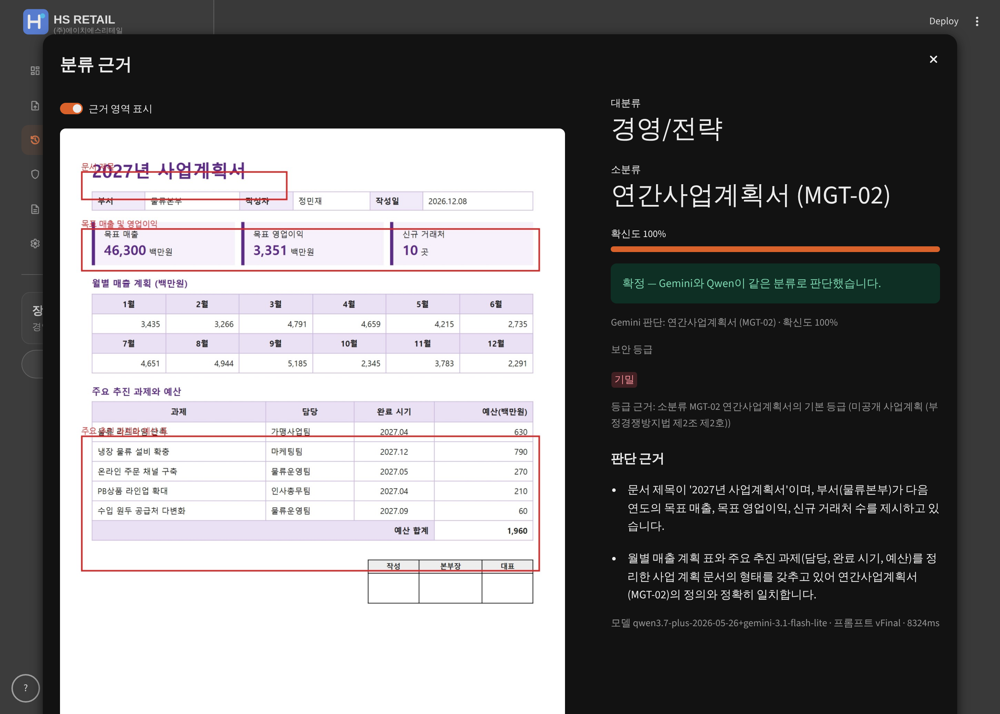
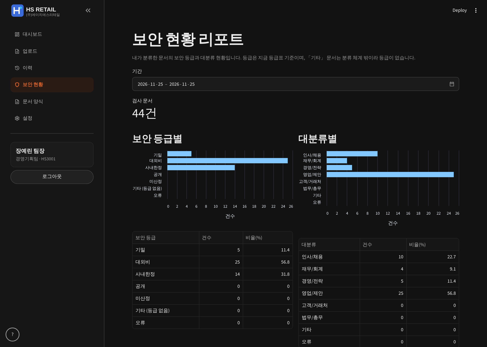
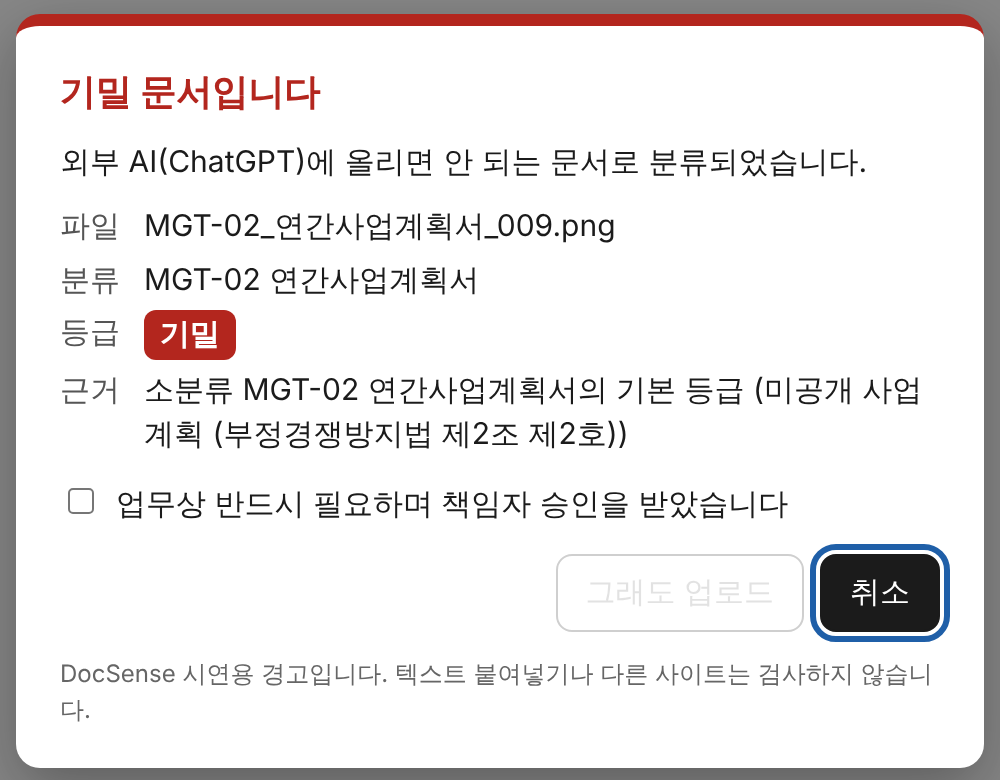
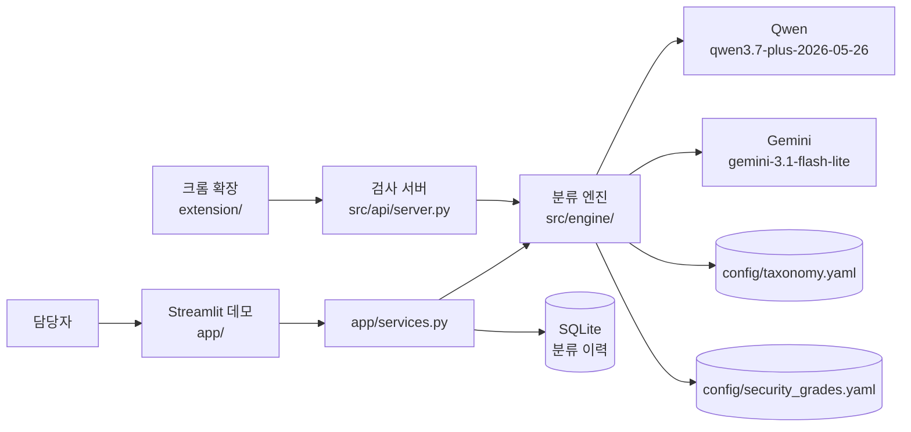
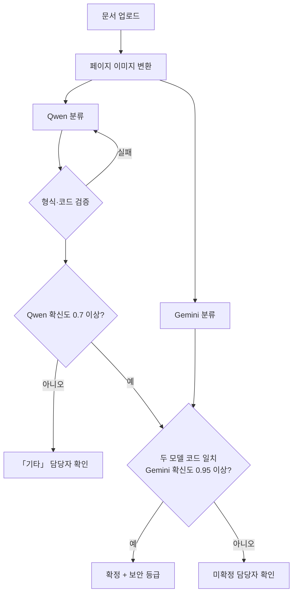

<div align="center">

# DocSense

**문서 이미지를 보고 어느 부서의 어떤 문서인지, 보안 등급은 무엇인지 근거와 함께 알려주는 VLM 문서 분류 엔진**


</div>

<p align="center"></p>

DocSense는 스캔본·이미지·PDF·DOC/DOCX 문서를 VLM(Qwen)이 직접 보고 **대분류 6종, 소분류 100종**으로 분류합니다. 다른 회사 모델(Gemini)이 같은 문서를 동시에 분류해, **두 모델의 코드가 같고 Gemini 확신도가 0.95 이상일 때만 확정**합니다. 확정된 문서에는 소분류별 **보안 등급(기밀·대외비·사내한정·공개)**과 법령 근거를 붙입니다.

융합보안프리캡스톤디자인 산학협력 과제(협력 기업 ㈜소만사)로 2026년 2학기에 만들었습니다. 문서는 모두 가상 회사 HS리테일(제과·음료 B2B 유통)을 배경으로 만든 합성 문서입니다.

## 목차

1. [주요 기능](#주요-기능)
2. [시스템 구조](#시스템-구조)
3. [빠른 시작](#빠른-시작)
4. [사용법](#사용법)
5. [분류 체계와 보안 등급](#분류-체계와-보안-등급)
6. [평가 결과](#평가-결과)
7. [한계](#한계)
8. [폴더 구조](#폴더-구조)
9. [문서](#문서)
10. [팀](#팀)
11. [데이터 출처와 고지](#데이터-출처와-고지)

## 주요 기능

| 기능 | 설명 |
|---|---|
| 계층 분류 | 대분류 6종 → 소분류 100종. 분류 체계 밖 문서는 「기타」로 보내 담당자가 확인 |
| 판단 근거 | 근거 문장과 근거 영역 좌표(0~1000 상대값)를 함께 내고, 원본 위에 박스로 표시 |
| 교차 확인 | Qwen과 Gemini를 동시에 호출. 코드 일치 + Gemini 확신도 0.95 이상이면 확정, 나머지는 미확정(담당자 확인) |
| 가드레일 | 응답 JSON 형식, 코드 존재, 코드–이름 일치, 확신도 범위를 검사하고 어기면 최대 2회 재요청 |
| 보안 등급 | 소분류별 기본 등급과 근거 조문(`config/security_grades.yaml`). 「기타」는 등급 없음 |
| 다중 페이지 | PDF·긴 이미지를 페이지별로 나눠 함께 판단. DOC·DOCX는 LibreOffice로 PDF 변환 |
| 데모 | Streamlit: 업로드, 결과·근거, 이력, 보안 현황 리포트(CSV 내보내기), 양식 안내 |
| 업로드 경고 | ChatGPT에 파일을 올리기 전에 등급을 검사해 경고하는 크롬 확장(시연용 시제품) |

<table>
<tr>
<td width="50%"></td>
<td width="50%"></td>
</tr>
<tr><td align="center">보안 현황 리포트</td><td align="center">ChatGPT 업로드 경고 (기밀)</td></tr>
</table>

## 시스템 구조



의존 방향은 `app/views` → `app/services` → `src/engine` → `config/` 한 방향입니다. `src/engine/`은 Streamlit을 import하지 않아 평가 스크립트에서도 그대로 씁니다.



## 빠른 시작

Python 3.10 이상이 필요합니다. 저장소 루트에서 실행합니다.

```bash
git clone <이 저장소 주소>
cd DocSense
python -m venv .venv
source .venv/bin/activate          # Windows: .venv\Scripts\activate
pip install -r requirements.txt
cp .env.example .env               # Windows: copy .env.example .env
streamlit run app/main.py
```

`.env`의 `DEMO_MOCK`이 `0`이 아니면(기본값) API 키 없이 **MOCK 모드**로 열립니다. 파일 이름 앞의 코드(예: `FIN-03_손익계산서.png`)로 가짜 결과를 만듭니다. Windows에서는 `run_demo.bat`을 더블클릭해도 됩니다.

실제 모델을 쓰려면 `.env`에 키를 넣고 `DEMO_MOCK=0`으로 바꿉니다.

| 변수 | 내용 |
|---|---|
| `VLM_API_KEY` | Alibaba Cloud Model Studio(싱가포르 리전) 키 |
| `VLM_MODEL` | 기본 `qwen3.7-plus-2026-05-26` (날짜 스냅샷 고정) |
| `GEMINI_API_KEY` | Google AI Studio 키. 비우면 모든 결과가 미확정 |
| `CONFIDENCE_THRESHOLD` | 이 값 미만이면 「기타」 (기본 0.7) |
| `PROMPT_VERSION` | `v1`·`v2`·`v3`·`vFinal` |

`.env`는 `.gitignore`에 들어 있습니다. API 키는 커밋하거나 채팅·이슈에 붙여 넣지 마세요.

## 사용법

```bash
# 문서 1건 분류 (결과 JSON과 근거 박스 그림)
python -m src.engine.classify <파일> --prompt vFinal --out results/check

# 프롬프트 확인 (API 호출 없음)
python -m src.engine.prompt vFinal

# 개발셋 일괄 분류와 정확도 요약
python -m src.engine.run --images <PNG 폴더> --prompt vFinal

# 엔진 호출 로그 요약
python -m src.engine.log_summary

# 테스트 (실제 API를 부르지 않음)
python -m pytest tests -q
```

크롬 확장은 [extension/README.md](extension/README.md)를 따릅니다. `python -m src.api.server`로 검사 서버를 켜고, `chrome://extensions`에서 `extension/` 폴더를 불러옵니다.

## 분류 체계와 보안 등급

| 대분류 | 소분류 수 | 예 |
|---|:---:|---|
| 인사/채용 (HR) | 14 | 이력서, 근로계약서, 재직증명서 |
| 재무/회계 (FIN) | 22 | 손익계산서, 감사보고서, 세금계산서 |
| 경영/전략 (MGT) | 14 | 거래처 매입매출현황 분석표, 연간사업계획서 |
| 영업/제안 (SAL) | 19 | 견적서, 발주서, 납품확인서 |
| 고객/거래처 (CUS) | 14 | 비밀유지계약서, 가맹계약서 |
| 법무/총무 (LEG) | 17 | 상가건물 임대차계약서, 표준임대차계약서 |
| 기타 (ETC-00) | 1 | 분류 체계 밖 문서 |

대분류는 문서를 만드는 업무 기능, 소분류는 그 기능의 문서 양식입니다(ISO 15489-1 업무분류 참고). 원칙과 경계 규칙은 [docs/taxonomy_principles.md](docs/taxonomy_principles.md)에 있습니다.

| 보안 등급 | 소분류 수 | 기준 |
|---|:---:|---|
| 기밀 | 9 | 공개 의무 없는 경영·재무·전략 정보 |
| 대외비 | 51 | 개인정보 또는 정해진 상대방에게만 열린 정보 |
| 사내한정 | 31 | 사외 공개용은 아닌 업무 문서 |
| 공개 | 9 | 대외 배포·게시를 전제로 만든 문서 |

등급 이름은 ISMS-P 인증기준 2.1.3 해설의 예시를 따랐습니다. 근거 조문 조사는 [docs/security_grade_legal_basis.md](docs/security_grade_legal_basis.md)에 있으며 법률 자문이 아닙니다.

## 평가 결과

프롬프트와 조합 규칙은 개발셋(dev)으로만 정했고, `vFinal`을 동결한 뒤(2026-11-17) 테스트셋(test)을 **1회** 측정했습니다. dev와 test는 문서 번호로 나눴습니다.

**test 1,216건 (소분류 100종, vFinal 동결본, 2026-11-17)**

| 항목 | 결과 |
|---|---|
| Qwen 소분류 정답 | 1,216 / 1,216 |
| Gemini 소분류 정답 | 1,215 / 1,216 |
| 합산 확정 (코드 일치 + Gemini 확신도 0.95 이상) | 1,215건 |
| 잘못 확정 | 0건 |
| 최상위 등급 문서 확정 | 131 / 131 (측정 당시 「극비」 10종 기준) |

**dev (Gemini 확신도 0.95 이상 규칙으로 다시 계산)**: Qwen 99.2%, Gemini 99.4%, 합산 확정 98.9%, 잘못 확정 2건. 잘못 확정 2건은 상단이 잘린 표준임대차계약서(LEG-02)를 두 모델이 모두 상가건물 임대차계약서(LEG-01)로 본 경우입니다.

평가에 쓴 dev 계열 문서는 정식 dev 1,136건, 열화 변형(hard·hard2) 528건, 줄글 문서 147건으로 모두 1,811건이고, 체계 밖 문서(OOD) 110건을 더하면 1,921건입니다. 변형 사례가 섞여 있어 모두 독립 문서는 아닙니다. 확신도 기준을 정한 표는 [results/prompt_tune/threshold_1117.md](results/prompt_tune/threshold_1117.md)에 있습니다.

## 한계

- **합성 데이터:** 실제 회사 문서가 아니라 가상 회사 문서로 평가했습니다. 손글씨나 비표준 양식은 반영하지 못했습니다.
- **같은 양식 공유:** dev와 test는 같은 기본 양식에서 만든 문서라, 처음 보는 양식에 대한 일반화는 검증하지 않았습니다.
- **미측정 항목:** 열화 test와 최종 OOD 60장은 동결본으로 측정하지 않았습니다.
- **잘린 문서:** 상단이 잘린 표준임대차계약서를 상가건물 임대차계약서로 보는 오류는 프롬프트로 고치지 못했습니다.
- **확신도:** 모델이 스스로 보고하는 값이라 틀린 답도 0.9 이상이 나옵니다. 그래서 두 번째 모델과 함께 판단합니다.
- **외부 API:** 클라우드 API를 쓰므로 실제 도입에는 사내 배포 모델이 필요합니다. 처리 시간은 실제 API 모드에서 문서 1건당 약 10~20초입니다.
- **업로드 경고 확장:** 시연용 경고이며 실제 전송 차단 장치가 아닙니다. 텍스트 붙여넣기와 다른 사이트는 검사하지 않습니다.

## 폴더 구조

```text
.
├── app/                 # Streamlit 데모 (main.py, services.py, views/, mock/)
├── config/              # taxonomy.yaml, security_grades.yaml, employees.yaml(가상 계정), forms.yaml
├── data/meta/           # dev·fewshot·OOD 라벨 (test 행은 공개본에서 뺌)
├── docs/                # 분류 체계 원칙, 데이터셋 구축 기록, DB 스키마, 보안 등급 근거, 화면 그림
├── extension/           # ChatGPT 업로드 경고 크롬 확장
├── results/prompt_tune/ # 반복 측정 묶음 정의, 확신도 기준 결정 기록
├── src/
│   ├── engine/          # 분류 엔진: prompt, guardrail, classify, cross_check, security, pages
│   ├── api/             # 크롬 확장용 로컬 검사 서버
│   ├── db/              # SQLite 저장소
│   └── eval/            # 합성 데이터 생성·변형·분할·평가 스크립트
├── tests/               # pytest (가짜 client로 API 없이 실행)
├── .env.example
├── requirements.txt
└── run_demo.bat
```

분야별 상세 문서: [분류 엔진](src/engine/README.md) · [데모 화면](app/README.md) · [데이터셋 구축](docs/dataset_build_log.md) · [크롬 확장](extension/README.md)

## 문서

최종 발표 자료와 결과보고서는 [Releases](../../releases)에 첨부합니다.

## 팀

팀 베리어 · 융합보안프리캡스톤디자인 (2026년 2학기) · 협력 기업 ㈜소만사

| 역할 | 담당 |
|---|---|
| 백엔드 1 · 분류 엔진 | VLM 연동, 프롬프트, 가드레일, 교차 확인, 보안 등급, 검사 서버 |
| 백엔드 2 · 데이터·평가 | 합성 데이터셋, 변형셋, 분할, 평가 스크립트, 분류 체계 |
| 프론트 · 데모·기록 | Streamlit 데모, 근거 시각화, 발표 자료, 개발 기록 |

## 데이터 출처와 고지

- 합성 문서는 [비즈폼](https://www.bizforms.co.kr/) 양식을 참고해 만들었습니다. 양식 원본(HTML 변환본, HWP·PDF)은 재배포 허락을 확인하지 못해 이 저장소에 넣지 않았습니다. 그래서 데모의 「문서 양식」 내려받기와 데이터 생성 스크립트 일부는 원본 없이 동작하지 않습니다.
- 문서 속 회사, 인물, 거래처, 주소, 사업자번호는 모두 가상입니다.
- 교육 목적으로 만든 프로젝트이며 실제 서비스로 운영하지 않습니다.
