# 데모 화면 (app) 작업 정리 — 프론트

> 담당: 프론트 (데모 · 기록) · 기준: `main` (작업은 `feat/`·`fix/`·`docs/` 브랜치 → PR, Approve 후 병합) · 최종 갱신: 2026-10-12
> Streamlit 데모 화면과 가짜 결과 JSON 작업이 어디까지 됐는지, 사용법, 다음 할 일을 정리했습니다.
> 분류 엔진 작업은 `src/engine/README.md`, 평가 결과는 `results/README.md`, 프로젝트 전체 소개는 루트 `README.md`를 보세요.

PNG·JPG·PDF·TXT·CSV 문서를 올리면 분류 결과와 판단 근거를 보여주고, 분류 체계 밖 문서는 담당자가 승인하도록 하는 데모 화면입니다. **화면 4개와 가짜 결과 4종이 완성됐고, 실제 엔진 모드 연동은 백엔드 1이 확인했습니다.**

2주 차(10-08~12)에는 여러 쪽 묶어 올리기, SQLite 저장소 연결, 승인한 신규 분류를 분류 체계에 추가(FR-10)까지 마쳤고, 실제 엔진 모드에서 근거 박스·오류 문구·FR-10을 직접 확인했습니다.

---

## 1. 할 일과 결과

| 할 일 | 결과 | 위치 |
| --- | --- | --- |
| Streamlit 프로젝트 생성, 페이지 뼈대 | ✅ 업로드, 분류 결과, 승인 대기, 이력 화면과 사이드바 | `app/main.py`, `app/views/` |
| 화면과 엔진 연결 지점 | ✅ 화면은 `services.py`만 부름. MOCK·실제 엔진 전환 | `app/services.py` |
| 3절 형식 가짜 결과 JSON | ✅ 4종 (정상 2, 「기타」 1, 확신도 낮음 1) | `app/mock/samples/` |
| 가짜 결과를 MOCK 모드에 연결 | ✅ 파일명으로 4가지 경우를 골라 보여줌 | `app/services.py` |
| 실제 엔진 모드 연동 | ✅ 업로드 → 결과 → 근거 박스 → 이력, 「기타」 흐름 정상 (백엔드 1 확인) | `app/` |
| MOCK 모드 화면 직접 확인 | ✅ 프론트 PC에서 10개 항목 모두 정상 (2026-10-05) | `docs/images/` |
| 데이터셋 구축 과정 기록 | ✅ 양식 HTML 변환 → LLM 생성 → 주입 → 렌더링 → 하드셋·분할·OOD, 확인 필요 사항 5건 | `docs/dataset_build_log.md` |
| 여러 쪽 이미지 묶어 올리기 | ✅ 단건 분류에서 "한 문서의 여러 페이지" 선택 → 올린 순서대로 `_p1`, `_p2` …로 저장하고 `_p1`을 분류 (엔진 수정 없음). 캐시 키는 모든 페이지 해시 | `app/services.py`의 `save_pages`, `app/views/upload.py` |
| 데이터셋 지적 사항 수정 (백엔드 1·2 동의) | ✅ 여러 쪽 문서 전체 페이지 분류, OOD 60장 재생성(정답 단서 제거), 생성 기록 정정. 재측정은 백엔드가 새 모델로 완료(#41·#47·#49) | `src/engine/pages.py`, `src/eval/render_ood.py`, `docs/데이터셋_지적사항_확인.xlsx` |
| **2주 차** | | |
| 실제 엔진 모드 화면 캡처 | ✅ v2·고정 모델로 정상 1장·여러 쪽·hard·개발용 OOD 근거 박스 확인, `docs/images/` 교체 (10-10) | #33 |
| 실제 오류 문구 확인 | ✅ 잘못된 키(401)·인터넷 끊김 안내 문구 확인. 429는 가짜 응답으로만 | #34 |
| 근거 문장 일반 텍스트 표시 | ✅ 모델이 쓴 마크다운 기호가 화면 모양을 깨지 않게 `services.plain()` | #35 |
| 저장소 SQLite 연결 | ✅ `services.open_store()` 한 곳에서 `SqliteStore`를 엶. 서버를 다시 켜도 이력·승인 대기·NEW 번호 유지, MOCK은 DB 파일 분리 | #36, #39 |
| 승인 화면 정의 입력칸 | ✅ 기본값은 모델의 제안 이유 (확신도 낮음은 빈칸), 정의가 비면 승인 불가 | #44 |
| 승인 → 분류 체계 (FR-10) | ✅ 백엔드 1의 `add_minor()`로 정식 코드(예: `HR-04`) 발급 → 묶인 문서 확정. 분류 체계는 모드별 복사본. 실제 모드에서 같은 종류 다음 문서가 새 코드로 분류되는 것까지 확인 (10-12) | #48, #50, #53 |
| 병합된 main 전체 테스트 | ✅ `956d8cd`에서 96 passed (10-11) | #44 댓글 |

---

## 2. 실행하기 (저장소 루트에서)

처음 설치(가상환경, `.env.example` 복사, API 키 넣기)는 루트 `README.md`를 따릅니다. Windows는 아래 `run_demo.bat`이 알아서 합니다.

```bash
git pull origin main
pip install -r requirements.txt
streamlit run app/main.py
```

**Windows는 `run_demo.bat` 더블클릭으로도 켤 수 있습니다.** 처음 실행 때 `.venv` 가상환경 생성, 패키지 설치, `.env` 복사(MOCK 모드)를 알아서 하고 데모를 띄웁니다. 끄려면 검은 창을 닫습니다. Streamlit 첫 실행 때 묻는 이메일 질문은 건너뛰도록 해 두었습니다. 배치 파일 안내 문구는 Windows 코드 페이지 문제로 창이 바로 닫히는 것을 막으려고 영어로 썼습니다. 창이 바로 닫히면 저장소 폴더에서 터미널을 열고 `run_demo.bat`을 입력해 메시지를 확인합니다.

| 하고 싶은 것 | 명령 |
| --- | --- |
| 데모 (MOCK, API 비용 없음) | `streamlit run app/main.py` |
| 데모 (실제 API) | `.env`에서 `DEMO_MOCK=0` 후 `streamlit run app/main.py` |
| 데모 로직 테스트 | `python -m pytest tests/test_app_services.py tests/test_mock_samples.py -q` |
| 전체 테스트 | `python -m pytest tests -q` |
| 이력·승인 대기·NEW 번호 초기화 | 데모를 끈 뒤 `data/db/docsense_mock.sqlite3`(MOCK) 또는 `data/db/docsense.sqlite3`(실제 모드) 파일 삭제 |
| 데모에서 승인한 신규 분류 초기화 | **(2026-11-09부터 복사본을 쓰지 않음, 맨 아래 「분류 체계 직접 읽기」 참고)** 데모를 끈 뒤 `data/db/taxonomy_mock.yaml`(MOCK) 또는 `data/db/taxonomy_demo.yaml`(실제 모드) 삭제. 다음 실행 때 `config/taxonomy.yaml`에서 다시 복사됨 |

반드시 저장소 루트에서 실행합니다. `services.py`가 루트 기준으로 엔진(`src/`)을 불러옵니다.

### MOCK 모드에서 경우별로 보기

API를 부르지 않고 파일명으로 결과를 고릅니다. 결과는 파일명으로만 정해지지만, 시연·캡처용으로 **`app/mock/uploads/`에 가짜 근거 좌표에 맞춘 문서 4개**를 넣어 두었습니다. 그대로 올리면 근거 박스가 제목·표·결재란에 딱 맞게 그려집니다.

| 올릴 파일 이름 | 보이는 결과 | 바탕 샘플 |
| --- | --- | --- |
| `FIN-03_손익계산서_001.png` | 정상 분류 (코드 부분을 바꾸면 그 문서로 나옴) | `01_normal_single.json` |
| `FIN-09_감사보고서_003.pdf` (여러 페이지 PDF) | 정상 분류, 페이지마다 근거 박스 | `02_normal_multipage.json` |
| `LEG-02_표준임대차계약서_006_hard.png` | 확신도 낮음 → 승인 대기, 반려 기본 선택 | `04_low_confidence.json` |
| `출장정산서.png` (코드로 시작하지 않는 이름) | 「기타」 → NEW-xx 가분류, 파일명이 제안 분류명 | `03_etc_new_class.json` |
| 열리지 않는 파일 (예: 확장자만 `.png`인 텍스트 파일) | 오류 결과, 일괄 분류에서 실패 건수로 표시 | — |

---

## 3. 화면별 기능

| 화면 | 기능 | 요구사항 |
| --- | --- | --- |
| 업로드 | 단건: 미리보기(PDF는 첫 페이지) 후 분류, 결과 화면으로 이동 | FR-01 |
|  | 단건 "한 문서의 여러 페이지": 페이지 이미지 여러 장을 올린 순서대로 한 문서로 분류, 쪽 번호 미리보기 | FR-01 |
|  | 일괄: 진행률, 결과 표, CSV 내려받기(엑셀 한글 호환), 실패 건수 표시 | FR-02 |
| 분류 결과 | 원본 위 근거 박스(켜기/끄기), 다중 페이지 넘기기, 대분류·소분류·확신도, 판단 근거 | FR-04, FR-06, FR-07 |
|  | 「기타」·확신도 낮음 경고, 이전 결과 재사용 표시. 「기타」로 빠진 문서는 대분류 「기타」·ETC-00으로 보이고 모델이 본 문서 종류는 참고로만 보임 | FR-08 |
| 이력 | 전체 결과 표, 대분류·상태·파일명 필터, 결과 화면으로 이동 | FR-11 |

---

## 4. 구조와 설계 결정

```text
app/
├── main.py              # 로그인, 페이지 등록, 사이드바 (사원별 저장소)
├── services.py          # 화면과 엔진·저장소 사이의 유일한 연결 지점
├── mock/samples/        # 3절 형식 가짜 결과 4종 (MOCK 모드가 사용)
├── mock/uploads/        # 시연용 업로드 문서 4개 (샘플의 근거 좌표에 맞춰 그린 가상 HS리테일 문서)
└── views/
    ├── upload.py        # 단건/일괄 업로드
    ├── (분류 근거는 evidence.py 팝업, 프로그램 설명은 guide.py 팝업)
    ├── dashboard.py · forms.py · login.py  # 대시보드(대분류 맵), 문서 양식, 로그인
    └── history.py       # 분류 이력
tests/
├── test_app_services.py # 데모 로직 테스트
└── test_mock_samples.py # 가짜 결과 형식 검사 2개
```

- **화면은 `services.py`만 부릅니다.** 엔진이나 DB가 바뀌어도 화면 코드는 고치지 않게 하려고 연결 지점을 하나로 모았습니다.
- **MOCK 모드가 기본입니다.** API 비용 없이, 엔진 진행 상황과 관계없이 화면을 만들고 시연할 수 있습니다.
- **결과 형식은 회의 문서 3절 JSON 그대로입니다.** 엔진 결과와 같아서 실제 모드로 바꿔도 화면 수정이 필요 없습니다. 형식이 바뀌면 `tests/test_mock_samples.py`가 실패해서 샘플이 옛 형식으로 남지 않습니다.
- **근거 박스 좌표는 0~1000 기준입니다.** 그리는 함수는 엔진(`src/engine/pages.py`)에 있고 화면은 `services.draw_evidence()`로 부릅니다.
- **저장소는 SQLite(`src/db/store.py`의 `SqliteStore`)이고 서버 전체에서 하나입니다.** `services.open_store()` 한 곳에서만 만듭니다. 새로고침하거나 탭을 여러 개 열어도 같은 이력과 승인 대기를 보고, 서버를 다시 켜도 남습니다. NEW-xx 번호도 이 저장소 하나에서만 발급합니다.
- **MOCK과 실제 모드는 DB 파일을 따로 씁니다** (`data/db/docsense_mock.sqlite3`, `data/db/docsense.sqlite3`, 둘 다 커밋 안 함). 가짜 결과가 실제 이력·번호에 섞이지 않습니다. `DEMO_MOCK`을 바꾸면 데모를 다시 켜야 다른 파일을 엽니다.
- **(2026-11-09부터 복사본을 쓰지 않음, 맨 아래 「분류 체계 직접 읽기」 참고)** **분류 체계도 모드별 복사본을 씁니다** (`data/db/taxonomy_mock.yaml`, `data/db/taxonomy_demo.yaml`, `services.taxonomy_file()`). 데모에서 승인한 신규 분류가 실제 `config/taxonomy.yaml`(백엔드 2 담당, 커밋 대상)을 바꾸지 않고, MOCK의 가짜 승인이 실제 모드 분류에 섞이지 않습니다. 화면·엔진·`add_minor()`가 모두 이 파일 하나를 봅니다. `.env`에 `TAXONOMY_PATH`를 적으면 그 파일을 씁니다.

---

## 5. 문제 해결 과정

뼈대를 만든 뒤 구조를 다시 점검해서 찾고 고친 문제입니다.

| 문제 | 영향 | 해결 |
| --- | --- | --- |
| API 오류(키 오류, 한도 초과, 연결 실패)가 화면까지 그대로 올라옴 | 시연 중 빨간 오류 화면, 일괄 분류 중 1건 실패 시 전체 중단 | 모든 예외를 안내 문구가 담긴 오류 결과로 바꿈. 일괄 분류는 실패 건을 남기고 계속 진행 |
| 호출 속도 제한이 없음 | 스냅샷 모델(분당 60~120건)에서 한도 초과 | 호출 사이 1초 간격, 한도 초과 시 2·4·8초 대기 후 최대 3회 재시도 |
| 화면 조작마다 PDF를 다시 변환 | 다중 페이지 문서에서 느려짐 | 페이지 이미지 캐시 |
| 같은 파일을 다시 올리면 API 재호출 | 비용과 시간 낭비 | 파일 해시·프롬프트·모델이 같으면 이전 결과 재사용. 오류 결과는 재사용하지 않음 |
| NEW-xx 번호를 정하는 곳이 세 군데 | 새로고침 후 번호가 어긋남 | 저장소 하나가 번호를 발급하고 MOCK·실제 엔진이 같은 발급기를 씀 |
| 승인이 문서 단위 | 같은 제안 10건을 10번 승인, 이름 수정이 1건에만 반영 | NEW 코드 단위로 묶어 한 번에 결정 |
| 확신도만 낮은 문서도 "승인"이 기본 | 이름 없는 분류가 생길 수 있음 | "반려"를 기본으로, 이름 없으면 승인 버튼 막음 |
| MOCK 모드가 정상·「기타」 2가지만 보여줌 | 다중 페이지, 확신도 낮음 화면을 API 없이 확인 불가 | 가짜 결과 4종을 파일명으로 골라 쓰게 연결. 제안명 없는 확신도 낮음 문서는 서로 묶이지 않게 건마다 새 번호 |

---

## 6. 검증 상태

| 항목 | 상태 |
| --- | --- |
| 전체 테스트 `python -m pytest tests -q` (엔진·데모 로직·샘플 형식) | **96 passed** (2026-10-11, 병합된 main `956d8cd`, 프론트 PC). 이후 #48 브랜치 103 passed (10-12). 1주 차는 51 passed (10-05) |
| 근거 박스 위치·한글 라벨 | 테스트 이미지에 그려서 눈으로 확인 |
| 실제 엔진 모드 화면 (`DEMO_MOCK=0`) | 정상 (1주 차 백엔드 1 확인, 2주 차 프론트 PC에서 다시 확인) |
| 실제 엔진 모드 근거 박스 위치 (`PROMPT_VERSION=v2`, 옛 모델 `qwen3-vl-plus-2025-12-19`, 10-10 지원 종료로 #37에서 교체) | 정상 (2026-10-10, 프론트 PC). dev 정상 1장 `SAL-01_견적서_002`, 여러 쪽 `FIN-03_손익계산서_002` 3쪽, hard `SAL-01_견적서_002`(촬영 그림자), 개발용 OOD `DEVOOD-01_휴가신청서_001` 모두 박스가 제목·표 위치에 맞음. 4건 모두 확신도 0.98, OOD는 「기타」(NEW-01). test 분할·최종 OOD셋은 쓰지 않음 |
| MOCK 모드 화면 | 정상 (2026-10-05, 프론트 PC, 아래 화면 캡처) |
| 실제 401 오류 시 화면 문구 | 정상 (2026-10-10, 프론트 PC, 일부러 틀린 키로 실제 API 호출 → 약 2초 후 안내 문구, 아래 캡처) |
| 인터넷 끊김 시 화면 문구 | 정상 (2026-10-10, 프론트 노트북, main ZIP + 와이파이 끈 상태로 실제 엔진 모드 → 약 4초 후 안내 문구, 아래 캡처) |
| 실제 429 오류 시 화면 문구 | 미확인 (호출 한도를 실제로 넘기기 어려워 가짜 오류 응답으로 로직만 확인) |
| 여러 페이지 PDF의 MOCK 결과 | 정상 (감사보고서 3쪽 넘기기, 쪽마다 근거 박스) |
| 여러 쪽 이미지 묶어 올리기 | 테스트 4개 추가 (저장 순서, 캐시 키, 1장일 때, 제안명). 화면 확인 정상 (2026-10-10, 실제 엔진 모드, 손익계산서 3쪽이 한 문서로 분류되고 1·2·3쪽 넘기기). pytest 83 passed (2026-10-10, 프론트 PC, PR #33) |
| 승인 → 분류 체계 (FR-10) | 정상 (2026-10-12, 프론트 PC, 실제 엔진 모드, `qwen3.7-plus-2026-05-26`, 프롬프트 v2). 개발용 OOD `DEVOOD-01_휴가신청서_001` → 「기타」 `NEW-01` → 승인 시 `add_minor()`가 `HR-04` 발급, 문서 확정 → 다른 문서 `DEVOOD-01_휴가신청서_002`가 「기타」가 아니라 바로 `HR-04`(확신도 100%)로 분류. MOCK에서 이름 중복 거부(`SAL-01 '견적서'`)도 확인. pytest 103 passed |

- 전체 테스트는 프론트 PC에서 `.venv\Scripts\python -m pytest tests -q`로 실행합니다 (PDF 관련 테스트 포함). 작업 환경(클라우드)에는 pytest를 설치할 수 없어 PR마다 PC 결과를 댓글로 남깁니다.

---

### 화면: 실제 엔진 모드 (2026-10-10 프론트 PC, 프롬프트 v2, 고정 모델)

| 정상 분류 (견적서 1장) | 여러 페이지 이미지 (손익계산서 3쪽) |
| --- | --- |
| 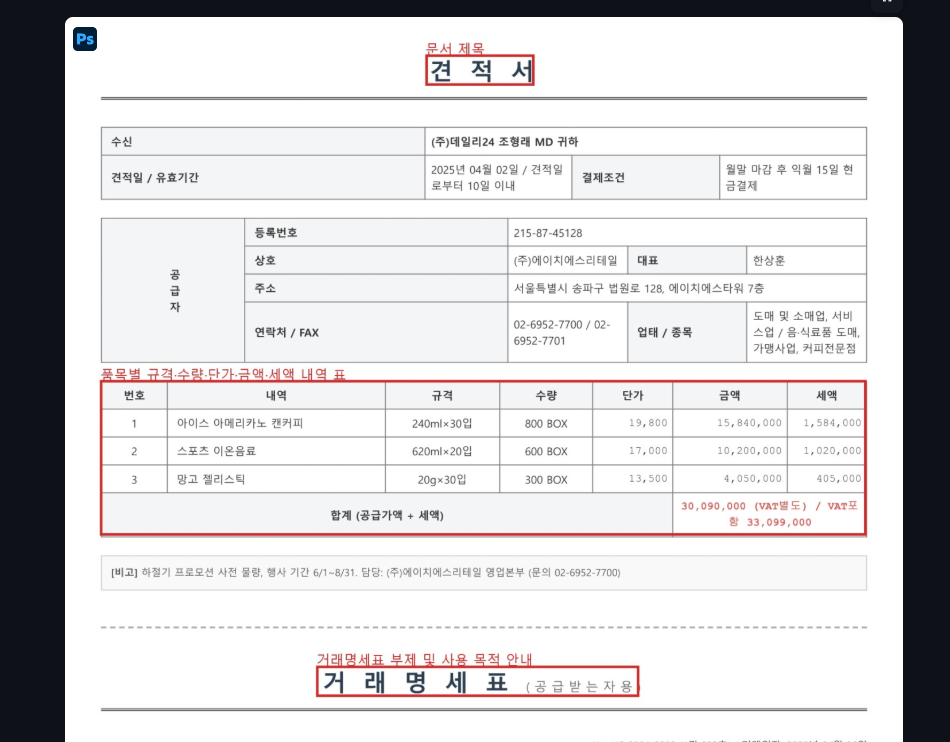 | 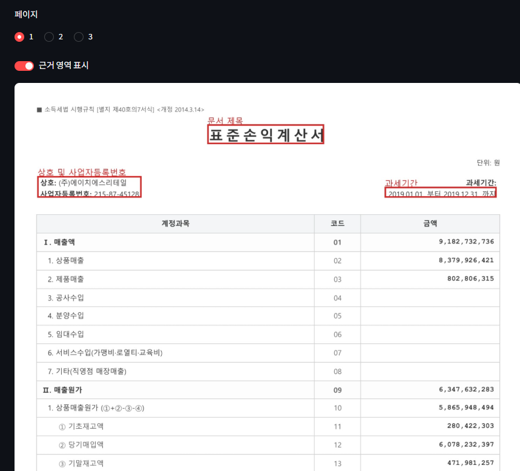 |
| **hard (촬영 그림자 견적서)** | **「기타」 가분류·신규 분류 제안 (개발용 OOD 휴가신청서)** |
| 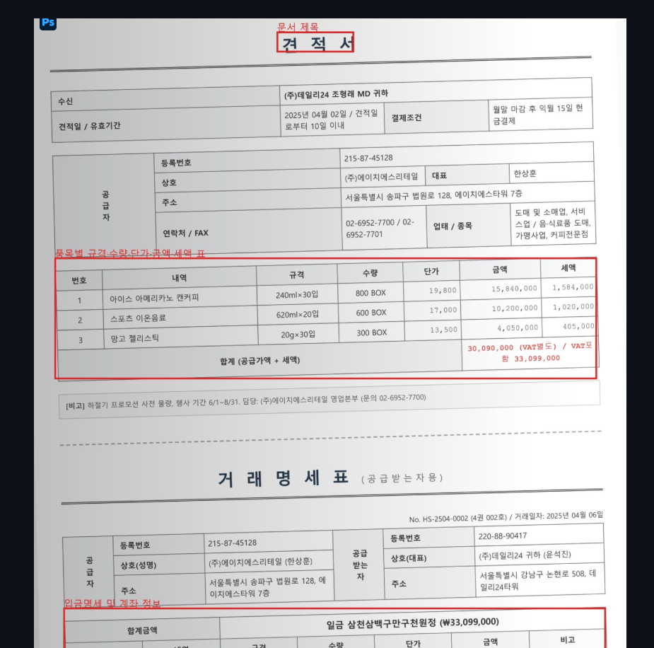 | 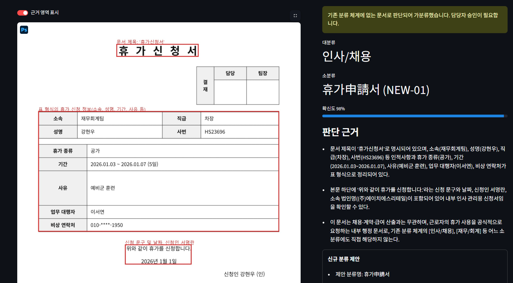 |
| **승인 대기 (NEW 코드 단위 결정)** | **분류 이력 (4건)** |
| 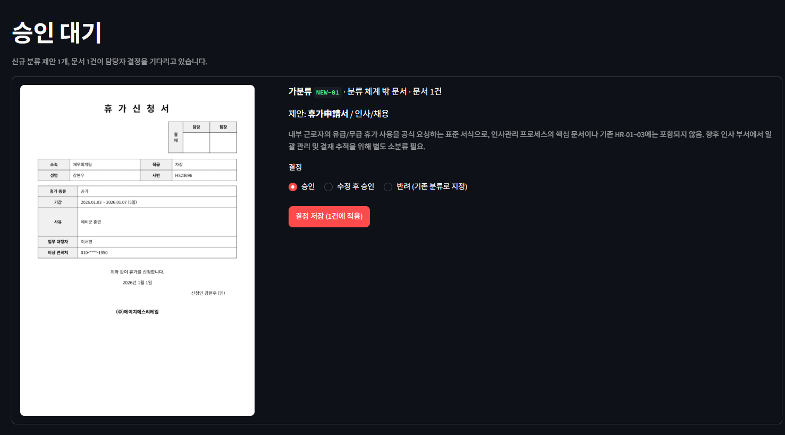 | 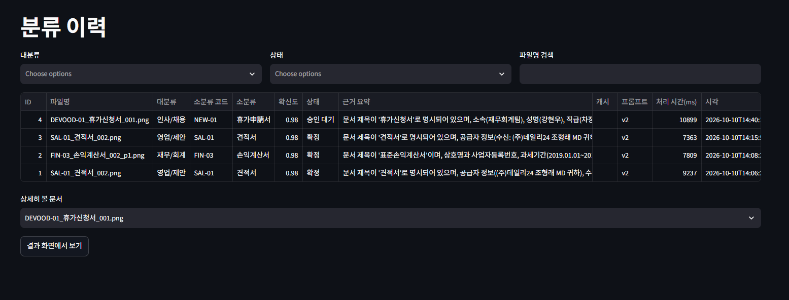 |

### 승인 → 분류 체계 (FR-10, 실제 엔진 모드, 2026-10-12 프론트 PC)

| ① 처음 보는 문서 → 「기타」 `NEW-01` | ② 승인 → `HR-04`로 확정 | ③ 같은 종류 다른 문서 → 바로 `HR-04` |
| --- | --- | --- |
| 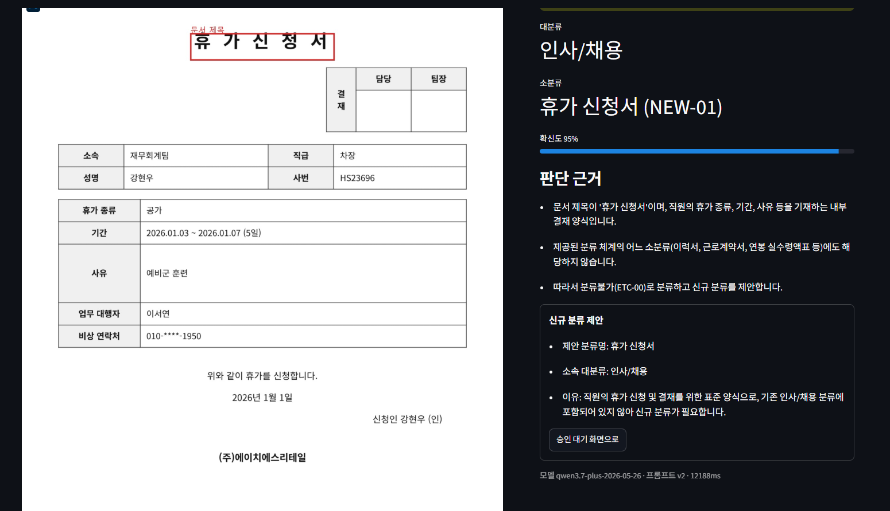 | 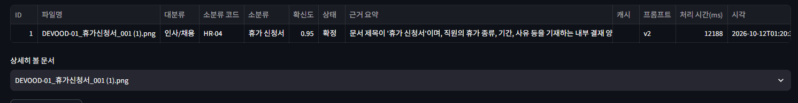 | 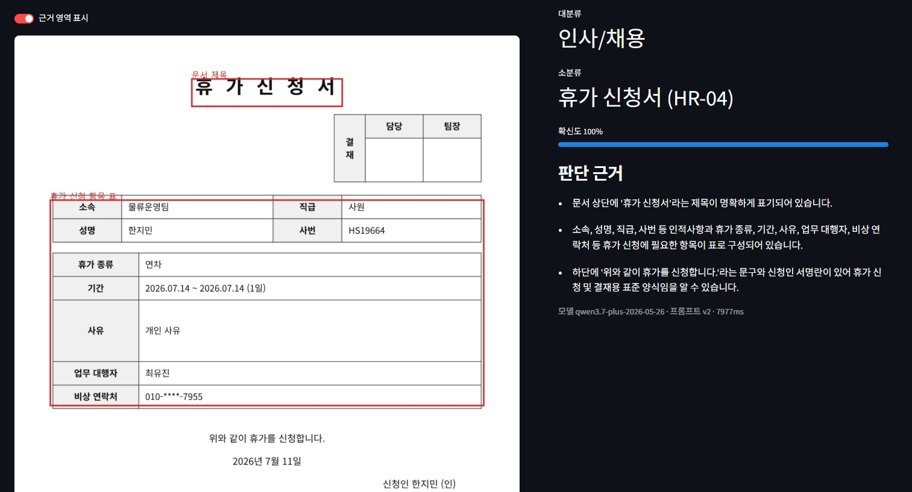 |

### 오류 문구 (실제 엔진 모드, 2026-10-10 프론트 PC·노트북)

| 잘못된 API 키 (401) | 인터넷 끊김 |
| --- | --- |
| 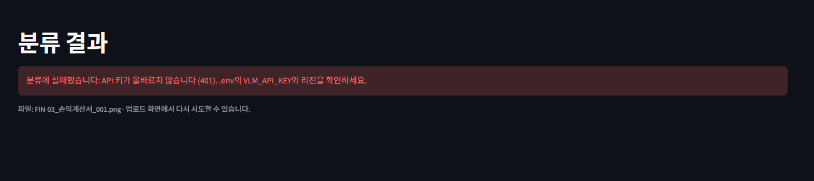 | 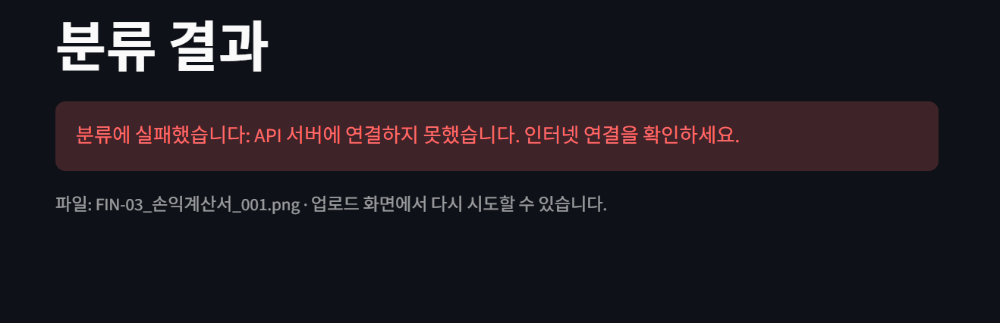 |

### 화면: MOCK 모드 (2026-10-05 프론트 PC)

| 확신도 낮음 | 일괄 분류 (실패 1건 포함) | 근거 영역 끄기 |
| --- | --- | --- |
| 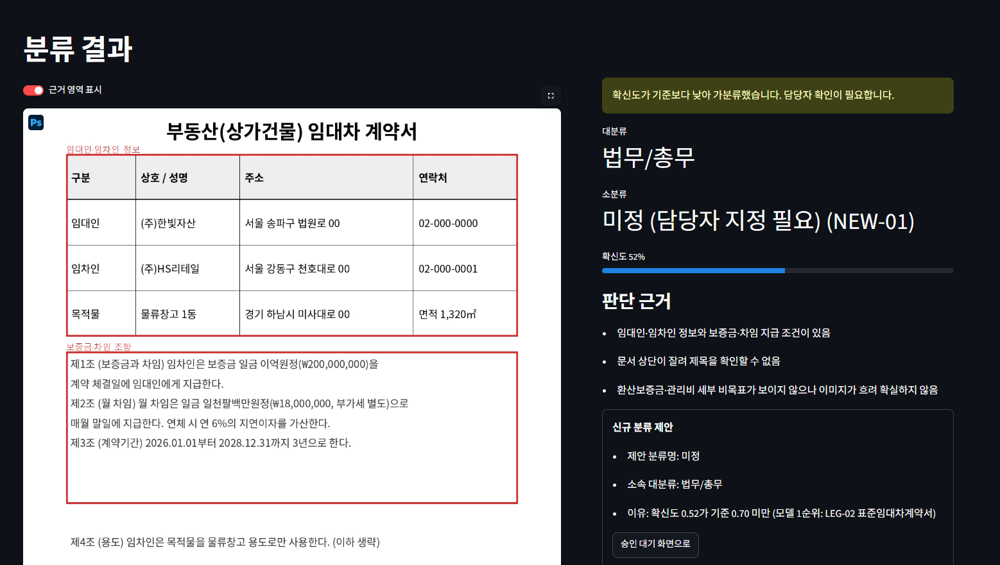 | 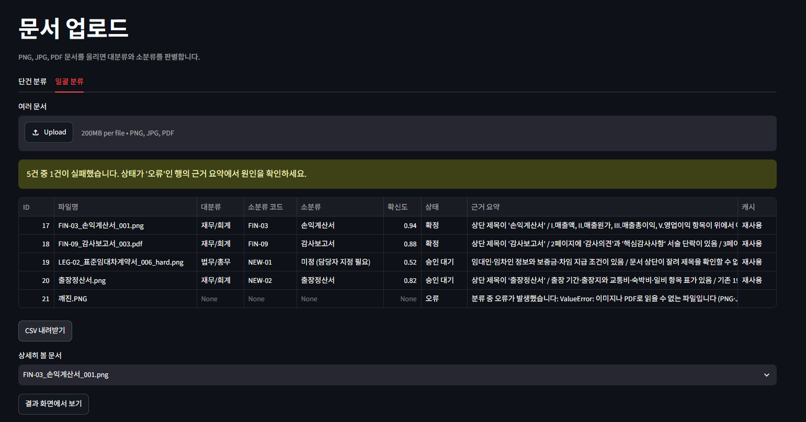 | 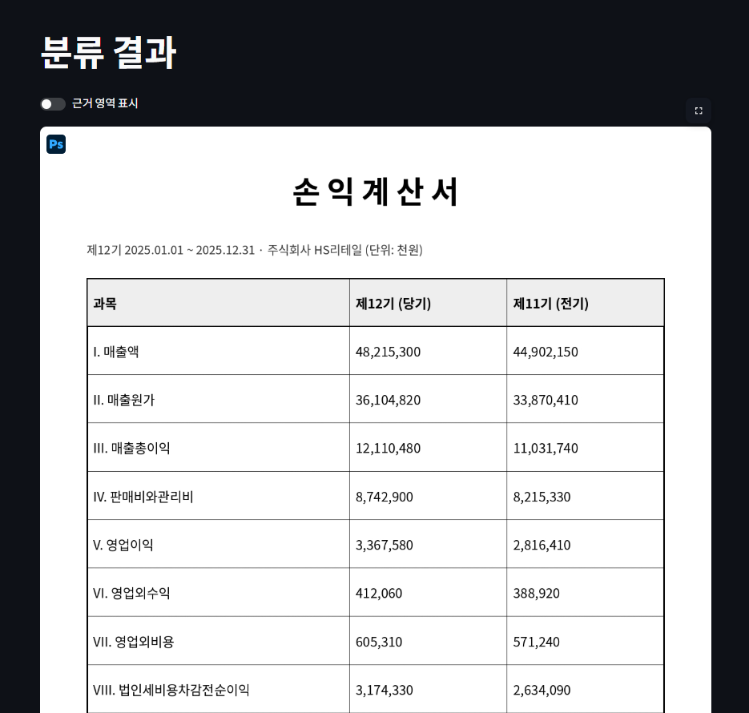 |

- 실제 엔진 모드에서는 4건 모두 확신도 0.98이라 "확신도 낮음" 화면이 나오지 않아 MOCK 캡처를 남겼습니다.
- 모델이 낸 제안 분류명이 "휴가申請서"처럼 한자가 섞여 나왔습니다 (위 「기타」·승인 대기 캡처). 승인할 때는 '수정 후 승인'으로 이름을 고쳐야 합니다. 프롬프트 쪽 확인 필요 (백엔드 1).

---

## 7. 팀원에게 알릴 것

**백엔드 1 (분류 엔진)**
- 여러 쪽 묶어 올리기는 `src/engine/pages.py`의 `_p1` 규칙(`_p1`이면 같은 폴더의 `_p2`, `_p3` …를 이어 읽음)에 기댑니다. 규칙을 바꿀 때 알려 주세요.
- 데모는 엔진에 분류 체계 경로를 넘깁니다(`Classifier(taxonomy_path=services.taxonomy_file())`). 승인은 `add_minor(이름, 대분류, 정의, path=)`를 부르고 받은 코드를 `decide_group()`의 `final_code`로 넘깁니다.

**백엔드 2 (데이터·평가)**
- 데모에서 승인한 신규 분류는 `data/db/taxonomy_mock.yaml`·`taxonomy_demo.yaml`(모드별 복사본)에만 들어가고 `config/taxonomy.yaml`은 바뀌지 않습니다. 공식 분류 체계에 넣을 때는 직접 옮겨 주세요.
- **(2026-11-09부터 복사본을 쓰지 않음, 맨 아래 「분류 체계 직접 읽기」 참고)** 복사본은 처음 실행 때 원본을 복사해 만듭니다. 원본 정의를 고치면 데모 쪽은 복사본을 지워야 반영됩니다.

---

## 8. 다음 할 일

- [x] 내 PC에서 MOCK 모드로 화면 4개와 2절 표의 4가지 경우 확인
- [x] 화면 캡처를 `docs/images/`에 저장하고 README에 연결 (GIF는 아직)
- [x] 저장소를 만드는 곳을 `services.open_store()` 한 곳으로 모음 (SQLite 교체는 그 함수의 한 줄만 고치면 됨)
- [x] SQLite 연결: 메모리 `Store`를 지우고 `open_store()`가 `SqliteStore`를 엶, MOCK은 DB 파일 분리 (백엔드 2와 협의, 10-11)
- [x] 승인 시 분류 체계에 새 분류 추가(FR-10): 백엔드 1의 `add_minor()`(#45)를 승인 화면에 연결, 모드별 복사본에 씀
- [x] 1주 차 발표 자료에 화면 흐름 넣기
- [ ] 2주 차 발표 자료: 실제 화면 캡처, 264건 수치 자리
- [ ] 발표 리허설 전에 데모 분류 체계 복사본(`data/db/taxonomy_mock.yaml`·`taxonomy_demo.yaml`) 지우기: #57(ETC-00 정의에서 예시 삭제)이 데모 프롬프트에도 들어가게 (백엔드 1 요청, #54 리뷰)
- [ ] 실제 429 오류 화면 (재현 어려움, 평가 중 실제로 나면 기록)

## 9. 알려진 한계

- DB 파일이 계속 커짐 (깃에는 올라가지 않음, 전시 전후로 파일을 지우면 초기화)
- 데모에서 승인한 신규 분류는 `data/db/`의 분류 체계 복사본에만 들어감. 팀 공식 `config/taxonomy.yaml`에 넣으려면 백엔드 2가 옮겨야 함 (의도한 동작, #45 합의)
- **(2026-11-09부터 복사본을 쓰지 않음, 맨 아래 「분류 체계 직접 읽기」 참고)** 복사본은 처음 실행 때 원본을 복사해 만들므로, 그 뒤 원본 정의가 바뀌어도 반영되지 않음. 복사본을 지우면 원본에서 다시 만들어지고 데모에서 승인한 분류는 사라짐
- 업로드 파일이 `data/uploads/`에 계속 쌓임 (깃에는 올라가지 않음, 전시 후 정리)
- 모델이 낸 근거 문장·제안명은 `services.plain()`으로 마크다운 기호를 무력화해 글자 그대로 보여 줌. 대신 여러 줄로 쓴 근거는 한 줄로 합쳐짐

---

## 로그인과 부서 (2026-11-05)

- 사번과 비밀번호로 로그인해야 화면이 열린다. 시연용 가상 계정이라 비밀번호는 평문으로 `config/employees.yaml`에 있고(사번별로 다름, 예: HS1001 / hs1001!) 보안 기능이 아니며 RBAC도 아니다. 로그인 화면의 「데모 계정 목록」에서 확인한다.
- 부서마다 담당 대분류가 정해져 있다 (`departments`). 대시보드는 담당 대분류의 소분류를 분류 체계에서 읽어 보여주고, 이력 화면은 담당 대분류를 기본 필터로 건다 (비우면 전체).
- 담당이 아닌 대분류로 확정된 문서는 결과 화면에서 「담당 부서에 전달」 안내를 띄운다.
- 디자인은 `.streamlit/config.toml`(어두운 테마, 주황 포인트)과 `app/style.py`(카드·사이드바)로 정한다.
- 「문서 양식」 화면은 모든 소분류의 양식을 대분류 탭으로 보여주고 `app/forms/`의 양식 원본(한글 HWP·PDF)을 그대로 내려받게 한다. 소분류↔파일 연결은 `config/forms.yaml`, 연결이 없으면 「양식 파일 준비 중」. 새로 승인된 소분류도 목록에 자동으로 나온다.
- 대시보드의 「대분류 보기」와 이력의 「보기」로 다른 대분류도 볼 수 있다 (기본은 우리 부서).
- 로고는 `app/assets/hs_logo.svg` (`data/html/assets/logo.svg`를 어두운 화면용으로 색만 바꿈).

### 2026-11-05 변경: 「기타」 승인 기능 제거 (1단계, 화면만)

- 회의 결정에 따라 「기타」 문서를 승인해 새 소분류로 만드는 흐름을 화면에서 뺐다. `views/review.py`, `services.approve_group()`, 사이드바 승인 대기 경고를 삭제했다.
- 「기타」로 빠진 문서(`status=pending_review`)는 화면에서 대분류 「기타」, 소분류 「기타(ETC-00)」, 상태 「기타」로 보인다 (`services.shown()`). 엔진·프롬프트·평가·DB는 그대로라서 기존 측정 결과와 비교할 수 있다. 엔진 정리(2단계)는 프롬프트 동결 뒤 백엔드 1이 한다.
- 분류 이력은 사원마다 DB 파일을 따로 쓴다 (`data/db/docsense[_mock]_<사번>.sqlite3`, `services.open_store(emp_id)`). 다른 사원의 이력은 보이지 않는다.
- 문서 양식은 HTML 조각을 쓰다 선·글자 깨짐 문제가 있어, 비즈폼에서 받은 원본 파일(HWP·PDF)을 `app/forms/`에 두고 그대로 내려받게 바꿨다 (`services.form_bytes()`). 파일 이름에서 「무료」·「(비즈폼)」은 뺐다. 감사 보고서(FIN-09)는 비즈폼 원본 HWP가 없어, 데이터셋 템플릿(`data/html/template_audit_report.html`)에서 입력값만 비워 만든 PDF를 쓴다.

## 2026-11-05 화면 개편 (2)
- 메뉴 순서: 대시보드 → 업로드 → 이력 → 문서 양식. 「분류 결과」·「프로그램 설명」 메뉴는 없앴다.
- 대시보드는 대분류 맵 하나만 둔다 (맵/목록 전환). 우리 부서 대분류는 주황색으로 빛나고, 원을 누르면 그 대분류로 분류한 내 문서가 나온다. 「기타」도 원 하나로 나온다.
- 업로드는 「분류」(파일 1개든 여러 개든 같은 방식)와 「분류 결과」 두 탭. 결과 표의 「분류 근거」를 누르면 `evidence.py` 팝업에 원본+근거 박스·판단 근거가 나온다 (이력 화면도 같은 팝업을 쓴다). 「한 문서의 여러 페이지」 올리기는 없앴다 (`services.save_pages`는 남겨 둠. 쓰이지 않으면 정리).
- 프로그램 설명은 사이드바 왼쪽 아래 ? 버튼의 팝업(`guide.py`)으로 옮기고 짧게 다시 썼다.
- 양식 파일 이름을 영문으로 바꿨다 (`config/forms.yaml`은 「화면 이름: 파일 이름」). 한글 파일 이름이 zip·윈도우에서 깨져 「양식 파일 준비 중」으로 뜰 수 있어서다.

## 2026-11-05 화면 개편 (3)
- 서비스 이름 「한성부기들의 서류 정리방」, 브라우저 탭 아이콘 🐢(탭 이름은 「HS리테일 문서 분류」), 문서 목록은 정렬(최신순/중요도순)·별(`services.starred`, `<DB>.stars.json`)·「분류 근거 보기」 (`doclist.py`).
- **설정** 화면(`views/settings.py`): 글자 크기, 언어(한국어/English), 사용 방법 안내(매일 처음 열 때/끄기, 「다시 보기」). 사원마다 `<DB>.settings.json`에 저장 (`services.load_settings/save_setting`).  밝은 테마는 Streamlit 화면 구조에 CSS를 덧씌우는 방식이라 선택 버튼·입력 칸 색이 끝내 맞지 않아 뺐다(11/6). 다시 넣으려면 `[theme.light]` 설정 방식을 먼저 검토한다.
- 번역은 `app/i18n.py`의 `t("한국어 문구")`와 영어 사전 `EN`. 사전에 없으면 한국어가 그대로 나온다. 파일 이름·모델이 쓴 판단 근거·오류 원인·사원 이름은 번역하지 않는다. 새 화면 문구를 추가하면 `EN`에도 넣는다 (`tests/test_app_i18n.py`가 자리표시자와 분류 이름 누락을 검사).
- 대시보드 맵: 우리 부서 대분류 원이 가운데, 나머지가 둘러싼다 (절대 위치, 원 안 글자는 「코드 + 대분류 이름」 두 줄만. 문서 건수는 마우스를 올리면 나온다).
- 업로드: 분류 중 「✕ 중단」(스트림릿은 버튼을 누르면 스크립트가 다시 실행돼 반복이 끊긴다. 지금 처리 중인 1건은 끝난 뒤 멈춘다). 끝난 문서는 저장되고 「이어서 분류하기」로 남은 문서부터 한다. 분류가 끝나면 근거 사진이 있는 결과 팝업(`evidence.open_results`)이 먼저 뜨고 ◀ ▶ 로 한 건씩 넘긴다.
- 파일 이름이 이미 분류한 문서나 같이 올린 파일과 같으면 새 이름을 묻는 팝업이 뜬다 (`services.name_conflicts/suggest_name`). 확장자는 유지한다.
- 사용 방법 안내(`tour.py`): 메뉴를 하나씩 밝게 가리키고 나머지는 어둡게 가린다. 아무 곳이나 누르면 다음 단계, 「건너뛰기」는 항상 있다. 숨은 iframe의 스크립트가 부모 화면에 겹침 층을 붙이는 방식이고, 하루 한 번 여부는 브라우저 저장소(`docsense_tour_<사번>`)의 날짜로 판단한다.

## 2026-11-09 대시보드 맵 한 화면 맞춤
- 맵의 원 크기·위치를 화면 높이에 맞춰 줄인다 (`views/dashboard.py`의 `--u`, 0.62~1배). 화면이 충분히 높으면(약 840px 이상) 예전과 같은 크기다. 제목 위쪽 여백도 줄였다 (`MAP_TOP`은 맵 위쪽이 쓰는 높이 가정값 190px).
- 대분류 문서 목록에서 「← 대분류 맵으로」를 누르면 맵이 **누른 원의 중심에서부터** 작게 모였다가 확 퍼지며 나온다 (`style.py`의 `zoomin` 0.3배 → 1배, 시작점은 `dashboard.py`가 `session_state.map_from`의 원 위치로 정한다). 「움직임 줄이기」 설정(prefers-reduced-motion)에서는 꺼진다.
- 실제 브라우저에서 보지 못하고 만든 CSS다. 원 안 글자가 잘리거나 제목이 가려지면 `MAP_TOP`과 0.62를 조정한다.

## 2026-11-09 분류 체계 직접 읽기
- 데모는 `config/taxonomy.yaml`(또는 `.env`의 `TAXONOMY_PATH`)을 바로 읽는다. `data/db/taxonomy_mock.yaml`·`taxonomy_demo.yaml` 복사본은 더 만들지 않는다.
- 이유: 신규 분류 승인 화면이 없어져 복사본에 쓰는 코드가 없고, 복사본이 있으면 원본의 소분류가 늘어도(19→25종) 화면이 옛 목록을 계속 보여 주었다.
- 예전에 만들어진 복사본 파일은 쓰이지 않으니 지워도 된다. 소분류 수는 화면이 분류 체계에서 직접 세므로 숫자를 고칠 곳이 없다.
- 소분류에 양식 파일이 없으면(`config/forms.yaml`에 없음) 문서 양식 화면에 「양식 파일 준비 중」으로 나온다. 새 소분류 6종은 지금 이 상태다.

## 2026-11-10 업로드 1건 분류에도 문서 전송 애니메이션
- 문서 1건을 올려 분류할 때는 「업로드 → 분류」 문서 전송 애니메이션을, 여러 건이면 기존 진행 막대를 보여 준다 (`views/upload.py`). 예전에는 애니메이션이 근거 팝업의 다시 시도에서만 나왔다.
- 사용자 화면은 실제로 열어 보지 못했다. MOCK 모드는 분류가 바로 끝나 애니메이션이 순식간에 지나간다.

## 2026-11-12 txt·csv 업로드와 이력 필터
- **txt·csv 업로드**: `services.SUPPORTED`에 txt·csv를 더했습니다. 엔진은 `src/engine/pages.py`에 txt·csv 분기만 추가했고(PDF·PNG 경로는 그대로), `load_pages()`가 글자를 흰 바탕 A4 이미지로 그려 PDF·PNG와 같은 방식으로 분류합니다. csv는 칸을 ` | `로 이어 그립니다.
  - 인코딩은 UTF-8(BOM 포함) → CP949 순으로 읽고, 둘 다 안 되면 한국어 오류 결과가 됩니다.
  - 한계: 1MB 초과는 받지 않고, 텍스트는 앞 5쪽(약 200줄), csv는 앞 200행까지만 그립니다. 표 서식은 그리지 않습니다.
  - 한글 글꼴은 기존 탐색(나눔고딕, 맑은 고딕, AppleGothic, Noto Sans CJK)을 씁니다. 하나도 없으면 한글이 깨져 그려집니다.
- **이력 화면**: 「검토 필요만 보기」 스위치(「기타」·오류만 남김)와 현재 필터 그대로 내려받는 「CSV 내려받기」(utf-8-sig)를 더했습니다.
- 테스트: `tests/test_pages_text.py`(변환·인코딩·한계·오류 문구·MOCK 분류).

## 2026-11-12 교차 확인(Gemini+Qwen 합산) 결과 표시
- 결과 화면(`evidence.cross_check`)에 **확정**(Gemini와 Qwen이 같은 분류) 또는 **미확정**(담당자 확인 필요, 사유와 Gemini의 판단)을 보여 줍니다. 이력·결과 목록에 「교차 확인」 열이 생기고(CSV에도 포함), 「검토 필요만 보기」는 미확정 문서도 포함합니다.
- 화면은 결과 JSON의 선택 필드 `cross_check`만 읽습니다. 없으면 아무것도 보여 주지 않으므로 엔진이 아직 이 필드를 내지 않아도 화면은 깨지지 않습니다.
  - 형식(백엔드 1 리뷰로 확정, 엔진 합산 함수는 아직 없음): `{"confirmed": bool, "reason": "agree|disagree|low_confidence|gemini_unavailable|qwen_unavailable", "threshold": 0.95, "gemini": {"minor_code": str, "confidence": float}}`
    - 기준값(0.95)은 화면에 하드코딩하지 않고 결과의 `threshold`를 그대로 보여 줍니다.
    - Gemini가 「기타」로 판단하면 `gemini.minor_code`는 `ETC-00`입니다(화면에는 「기타」).
    - `qwen_unavailable`은 Qwen 결과가 오류일 때만 씁니다. 합산 단계에서 붙이므로 `app/mock/samples`는 그대로입니다.
- MOCK 모드만 가짜 값을 채웁니다(`services._mock_cross_check`): 정상 분류는 확정, 「기타」·낮은 확신도는 미확정. `app/mock/samples`와 `tests/test_mock_samples.py`는 건드리지 않았습니다.
- 한계: 실제 엔진 모드에서는 합산 확정 함수가 없어 이 표시가 나오지 않습니다. 화면은 직접 열어 보지 못했습니다.
  - 11/17: 실제 모드도 Qwen·Gemini 동시 호출 + 합산이 연결되어 이 표시가 나옵니다(`.env`의 `GEMINI_API_KEY` 필요, `src/engine/README.md` 11절).

## 2026-11-16 결과 화면에 보안 등급·「기타」 안내·`etc` 사유 추가
- 결과 화면(`evidence.security_grade`)에 **보안 등급 뱃지**(기밀 빨강·대외비 주황·사내한정 파랑·공개 초록·미산정 회색, 글자도 같이 표시)와 등급 근거를 보여 줍니다. 표시 전용이며 마스킹·전송 차단은 하지 않습니다.
- 등급은 저장된 `security_grade` 대신 **지금 등급표(`config/security_grades.yaml`)로 다시 찾습니다**(`services.grade_info`, 보안 현황 리포트와 같은 기준). MOCK·이전 결과도 등급이 보이고 등급표를 고치면 바로 따라옵니다.
- 소분류가 확정되지 않았으면(등급표에 없음·교차 확인 미확정) **「(잠정)」**을 붙이고 "확정되기 전까지 대외비 이상으로 취급합니다"를 안내합니다(`handling_grade`, 기밀 문서를 낮게 보이게 하는 오류 방지).
- 「기타」 문서는 등급 없이 **「분류 체계 밖 문서, 담당자 확인 필요」**를 보여 줍니다(백엔드 1 요청).
- 교차 확인 사유 `etc`(두 모델 모두 「기타」) 문구를 추가했습니다. 한/영 문구는 `i18n.py`.
- 영어 모드에서 판단 근거(모델이 쓴 한국어 원문)는 번역하지 않고 「원문(한국어) 그대로 보여 줍니다」 안내만 붙입니다.
- 테스트: `tests/test_app_services.py`에 `grade_info` 3건. 한계: 화면(뱃지 배치·색)은 직접 열어 보지 못했습니다.
