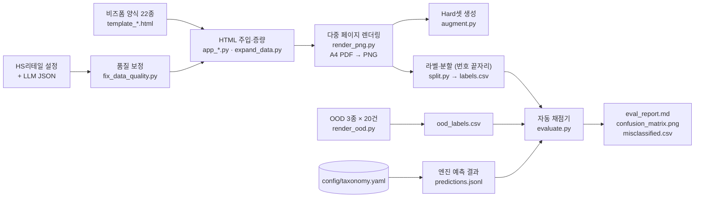

# 데이터셋 구축 및 정량 평가 (src/eval · data) 작업 정리 — 백엔드 2

> 담당: 백엔드 2 (데이터·평가) · 최종 갱신: 2026-11-15 (아래 1~7절의 수치는 10월 8일 기준이고, 11월 확장분은 4-4절과 7-5절에 있습니다)
> 합성 데이터셋 구축·증량, 품질 정제, 데이터 분할 표준화, Hard·OOD 검증셋 제작, 자동 채점기(`evaluate.py`) 구현 및 정량 평가 기록, 팀원에게 알릴 사항, 앞으로 할 일을 정리했습니다.
> 프로젝트 전체 소개(배경, 분류 체계, 데이터셋, 일정, 협업 규칙)는 `main` 브랜치의 README를 보세요.

비즈폼 양식 22종(소분류 19종)을 기반으로 가상 회사('HS리테일') 설정의 합성 문서 660건과 실전 예외 검증셋(Hard·OOD)을 구축하고, 분류 엔진의 예측 결과(`predictions.jsonl`)를 받아 정확도·Macro F1·혼동행렬·오분류표를 자동 산출하는 데이터·평가 파이프라인입니다.

**현재 상태 한눈에 (11/15)**

- 분류 체계는 소분류 19종에서 **100종 + 「기타」**로 늘었습니다 (19 + 승격 6 + 인사·고객·법무 37 + 재무·경영·영업 38). 정식 문서는 **2,655건**(fewshot 303 / dev 1,136 / test 1,216)이고 정답 라벨은 `data/meta/labels_100.csv`(PR #98)로 합칩니다. 자세한 구성은 4-4절.
- 개발셋 재측정(vFinal 프롬프트, Qwen·Gemini): 3번(정의 수정 전)과 5번(정의 수정 후)의 결과는 7-5절과 `results/README.md`에 있습니다. 백엔드 2 세트(A·B·C 591장) 합계는 Qwen 96.8% → 98.1%, Gemini 97.8% → 98.6%입니다.
- 남은 것: 100종 교체 PR(#102)과 정답 라벨 PR(#98) 병합, 동결 승인 후 test 1회 평가(백엔드 1), test 결과 정리와 최종 보고서(7번). 9절 앞부분 참고.

**10월 8일 기준 (초기 구축)**

- 정식 데이터셋 3배 증량 및 정제 완료: 초기 220건(양식당 10건) → **660건(22종 × 30건, 다중 페이지 분할 PNG 1,264장 / 1,089장)**, 설정·오타·세액 계산 오류 일괄 보정
- 분할·라벨 표준화(`split.py`) 완료: 번호 끝자리 기준 1:4:5 고정 분할(fewshot 66 / dev 264 / test 330), `FALLBACK_MAP`·개인 PC 경로·자동 git 실행 제거, 문서 단위 `labels.csv`(660행) 생성
- 특수 검증셋 구축 완료: 4가지 스캔·촬영 노이즈를 재현한 **Hard셋(1,264장)** 및 정답 단서를 제거한 분류 체계 밖 **OOD셋(3종 × 20건 = 60장)** 제작 완료
- 자동 채점기(`evaluate.py`) 및 초기 개발셋(88건) 정량 평가 완료: 소분류 정확도 **v1 92.05% → v2 97.73%**, **Macro F1 90.02% → 97.66%** (팀 목표 전 항목 달성)
- 다음: 남은 16개 소분류 정의–실제 문서 대조 → 다중 페이지 반영된 증량 개발셋(264건)·Hard·OOD 재측정 평가 및 SQLite 영구 저장소(`src/db/store.py`) 구현

---

## 1. 할 일 체크리스트

**1일 차 (양식 템플릿화 · 데이터 생성 · 품질 정제)**
- [x] 비즈폼 양식 22종 선정 및 Jinja2 HTML 템플릿(`template_*.html`) 변환 (유사 양식 3쌍 통합 → 6개 대분류 · 19개 소분류)
- [x] SVG 로고·직인·차트 생성(`create_assets.py`) 및 LLM 기반 양식별 JSON 생성 + 문서별 HTML 주입(`app_*.py`)
- [x] 데이터 품질 일괄 보정(`fix_data_quality.py`) — 가맹점주명(「이대호」)·대표자명(「정태민」) 통일, 가맹계약서 제목 오타 수정, 표준임대차 개정일 혼입 문구 제거, 원천징수영수증(`FIN-07`) 세액 계산식 검증 반영
- [x] 사용 LLM 모델명과 생성 프롬프트 이력 문서화 (`generation_info.md`, `1a65c71`)

**2일 차 (다중 페이지 렌더링 · 3배 증량 · 분할 표준화)**
- [x] HTML → A4 PDF → 200 DPI 페이지별 PNG 분할 렌더링 (`render_png.py`, `_p1.png`, `_p2.png`, `49a5854`)
- [x] 데이터 3배 증량 (`expand_data.py`) — 양식당 10건 → 30건, 총 660건으로 확장 (`39added`)
- [x] 번호 끝자리 기준 1:4:5 고정 분할 (`split.py`, 무작위 없음) — few-shot 66건 / dev 264건 / test 330건 (`e8fbc29`)
- [x] 하드코딩 및 중복 파일 정리 — 루트의 예전 `dev.csv`·`val.csv` 삭제(`ebf203a`), `split.py` 내 `FALLBACK_MAP` 및 개인 PC 절대 경로 제거, `config/taxonomy.yaml` 단일 참조 연동
- [x] 라벨 파일(`labels.csv`)이 다중 페이지 문서의 `_p1.png`를 가리키도록 문서 단위(660행) 정규화 (`38c8d2c`)

**3일 차 (특수 검증셋 Hard·OOD 구축 및 자동 채점기 구현)**
- [x] Hard셋 생성 (`augment.py`) — 시드 42 고정, 4가지 스캔·촬영 열화 변형 적용 (`369b500`, `39added`)
- [x] OOD셋 60건 생성 (`render_ood.py`, `ood_labels.csv`) — HS리테일 세계관 통일, 정답 단서 제거, 3종(법인카드지출결의서·주간업무회의록·부서간업무협조전) × 20건 구축 (`bb454d0`, `48c5e37`)
- [x] 자동 채점 파이프라인(`evaluate.py`) 구현 — 대·소분류 정확도, 클래스별 Precision·Recall·F1, Macro F1 자동 산출 및 OOD 채점 분리
- [x] 시각 리포트 및 초기 개발셋(88건) v1 vs v2 정량 비교 완료 — `eval_report.md`, `results/eval_comparison.md`, `confusion_matrix.png`, `misclassified.csv` 생성

**추가로 한 것 (협업 반영)**
- [x] 정의 3건 수정 동기화 (`LEG-01`·`LEG-02` 제목 기준 및 `(비즈폼)` 허용, `HR-03` 직원별 표 포함) — `config/taxonomy.yaml`, `make_taxonomy.py` 일치 확인 (`2674704`)
- [x] 프론트(`Seungjun` 브랜치)와 협업하여 다중 페이지 로더(`ece0780`), OOD 양식 분리(`48c5e37`), `generation_info.md` 현행화(`54c1ab9`) 반영

**이번 주 할 일 (2주 차)**
- [x] 남은 16개 소분류 정의를 실제 생성 문서(`fewshot`·`dev` 각 2~3개)와 대조해 표로 기록 및 수정 (`test` 문서는 열지 않음)
- [x] `evaluate.py` 보강 (PR #8, #11~#14: OOD 채점·토큰 합계·중복 줄·오분류 목록·혼동행렬·신뢰구간·확신도 기준표) — `split=ood` 행은 `status: pending_review`면 정답 처리, 「기타」 판정률(전체·3종별)과 제안 분류명 목록 분리 출력, `--pred` 폴더 저장 확인 및 `usage` 토큰 합계 표시
- [ ] SQLite 영구 저장소 설계 및 `src/db/store.py` 구현 (스키마 PR #9·구현 PR #15 완료, 프론트 승인 대기. DB 파일은 `data/db/docsense.sqlite3`) — 프론트와 스키마 공유, `data/docsense.db`(커밋 제외), 기존 `Store`와 동일한 함수 7개 및 단일 트랜잭션 기반 `NEW-xx` 번호 발급 구현

---

## 2. 처음 실행하기 (Windows 기준)

```cmd
git pull origin data_branch
python -m venv .venv
.venv\Scripts\activate
python -m pip install -r requirements.txt
playwright install chromium
```

| 하고 싶은 것 | 명령 |
| --- | --- |
| JSON 설정·품질 오류 일괄 보정 | `python src/eval/fix_data_quality.py` |
| 데이터 3배 증량 (220건 → 660건) | `python src/eval/expand_data.py` |
| HTML → A4 PDF → 페이지별 PNG 렌더링 | `python src/eval/render_png.py` |
| 분류 체계(`taxonomy.yaml`) 생성·동기화 | `python -m src.eval.make_taxonomy` |
| 1:4:5 고정 분할 및 `labels.csv` 생성 | `python src/eval/split.py` (이미지 폴더 필요) |
| 스캔·촬영 노이즈 Hard셋 이미지 생성 | `python src/eval/augment.py` |
| 분류 체계 밖(OOD) 60장 및 `ood_labels.csv` 생성 | `python -m src.eval.render_ood` |
| 엔진 분류 결과(`predictions.jsonl`) 정량 채점 | 아래 2-1절 |
| 승격 소분류 6종 문서 생성 (120장) | `python src/eval/render_new_minors.py` |
| 인사·고객·법무 37종 문서 생성 (925장) | `python -m src.eval.plan75.render_hcl` |
| 재무·경영·영업 38종 문서 생성 (950장) | `python -m src.eval.render_expansion` |
| 하드셋 2차(dev 264장) 생성 | `python src/eval/augment_hard2.py` |
| 개발용 OOD 합본 라벨 생성 | `python src/eval/merge_ood_dev.py` |
| 분류 체계 100종 파일·정답 라벨 생성 | `python -m src.eval.make_taxonomy_100`, `python -m src.eval.make_labels_100` (각 PR #94, #98) |

### 2-1. 정량 평가 및 리포트 생성 (`evaluate.py`)

분류 엔진(`run.py`)이 출력한 `predictions.jsonl`과 정답지(`labels.csv`, `ood_labels.csv`)를 대조해 정량 지표와 시각화 자료를 뽑습니다. API 호출 없이 로컬에서 즉시 실행됩니다.

```cmd
python -m src.eval.evaluate --pred results/v2/predictions.jsonl --labels data/meta/labels.csv
```

- 실행 결과는 `--pred`와 같은 폴더에 저장됩니다:
  - `eval_report.md`: 대분류·소분류 정확도, 19개 소분류별 정밀도(Precision)·재현율(Recall)·F1-Score, 전체 **Macro F1** 요약표
  - `confusion_matrix.png`: 19개 소분류 간 오분류 분포를 보여주는 히트맵 이미지
  - `misclassified.csv`: 오분류 문서의 `file`, `gold_code`, `predicted_code`, `confidence`, `status` 목록
- 버전 간 성능 변화폭 비교는 `results/eval_comparison.md`에서 확인합니다.
- **테스트셋(`split=test`, 330건) 주의:** 프롬프트가 최종 동결되기 전까지 `test` 분할 문서는 열어보거나 채점에 사용해 프롬프트를 수정하지 않습니다.

---

## 3. 처리 흐름



| 파일 | 하는 일 |
| --- | --- |
| `data/html/create_assets.py` | 가상 기업 로고, 대표이사 직인, 차트 등을 SVG로 생성해 `data/html/assets/`에 저장 |
| `src/eval/fix_data_quality.py` | LLM이 생성한 JSON의 인물명 불일치, 실존 인물명, 개정일 혼입 문구, 세액 오류 등을 일괄 보정 |
| `data/html/app_*.py` (22개) | 양식별 JSON 데이터를 Jinja2 템플릿(`template_*.html`)에 주입해 문서별 HTML 생성 |
| `src/eval/expand_data.py` | 초기 220건(양식당 10건)을 규칙 기반 변형으로 양식당 30건(총 660건)으로 증량 |
| `src/eval/render_png.py` | Playwright(Chromium)로 HTML을 A4 PDF로 변환 후 PyMuPDF로 200 DPI 페이지별 PNG(`_p1.png`…) 저장 |
| `src/eval/make_taxonomy.py` | 6개 대분류·19개 소분류 정의를 관리하고 `config/taxonomy.yaml`과 동기화 |
| `src/eval/split.py` | 스크립트 안의 `STANDARD_MAP`(파일 이름용 코드·이름 목록)으로 번호 끝자리 기준 1:4:5(fewshot/dev/test) 분할 후 `data/meta/labels.csv` 생성 |
| `src/eval/augment.py` | 깨끗한 원본 PNG에 4가지 스캔·촬영 열화 변형을 적용해 `data/images/hard/`에 저장 |
| `src/eval/render_ood.py` | 분류 체계 밖 문서 3종 × 20건 = 60장 PNG와 `data/meta/ood_labels.csv` 생성 |
| `src/eval/evaluate.py` | `predictions.jsonl`과 정답지를 비교해 정확도·Macro F1 산출, OOD 분리 채점, 혼동행렬 PNG·오분류 CSV 출력 |
| `src/db/store.py` | *(구현 예정)* 표준 라이브러리 `sqlite3` 기반 결과 캐시·이력·`NEW-xx` 검토 내역 영구 저장소 (`data/docsense.db`) |

---

## 4. 데이터셋 구성 및 라벨 형식

### 4-1. 전체 데이터셋 규모 요약

| 항목 | 수치 및 내역 |
| --- | --- |
| 양식 및 분류 체계 | 비즈폼 양식 22종 → **대분류 6종 · 소분류 19종** + `ETC-00`(기타) |
| 유사 양식 통합 (3쌍) | `HR-01` 이력서(기본·상세), `HR-03` 연봉 실수령액표(2025·2026), `SAL-01` 견적서(표준·통합) |
| 정식 문서 수 | **660건** (양식당 30건 → 일반 소분류 16종은 각 30건, 통합 소분류 3종은 각 60건) |
| 대분류별 문서 수 | 재무/회계 270 · 인사/채용 150 · 영업/제안 90 · 고객/거래처 60 · 법무/총무 60 · 경영/전략 30 |
| 깨끗한 이미지 (`clean/`) | **1,257장** (10-08 재렌더링: 증명사진·차트·직인 반영, '(비즈폼)' 제거. 이전 1,264장) |
| 하드셋 이미지 (`hard/`) | **1,257장** (10-08 재생성, 깨끗한 이미지 전부의 1:1 열화 변형본) |
| 이미지 배포 | GitHub Releases `data-clean-20261008`: clean zip 1개(165MB) + hard zip 2조각(각 2GB 미만) |
| OOD 이미지 (`ood/`) | **60장** (체계 밖 3종 × 20건) |
| 데이터 분할 (`labels.csv`) | **few-shot 66건 (10%) · dev 264건 (40%) · test 330건 (50%)** — 총 660행 |

### 4-2. LLM 내용 생성 JSON 구조 및 문서 간 수치 정합성

가상 회사 `(주)에이치에스리테일`(제과·음료 B2B 도매 유통 및 카페 프랜차이즈) 설정을 바탕으로, 문서 간 숫자가 서로 맞물리도록 JSON을 생성했습니다(예: 손익계산서의 당기총원가 = 원가명세서 합계, 견적서 단가 = 매입매출현황 수치). 섹션은 `필드`와 `표` 두 유형으로 통일했습니다.

```json
{
  "문서양식": "(비즈폼)표준 손익계산서",
  "문서수": 10,
  "문서목록": [
    {
      "문서명": "(비즈폼)표준 손익계산서",
      "문서ID": "FA-PL-01",
      "시나리오": "제1기(2018.04.12~2018.12.31) 표준손익계산서 - 원가명세서 Ⅸ 합계와 Ⅱ.2.② 당기총원가 일치",
      "섹션": [
        {"섹션": "헤더", "유형": "필드", "필드": {"상호": "(주)에이치에스리테일", "사업자등록번호": "215-87-45128"}},
        {"섹션": "손익계산서 본문", "유형": "표", "헤더": ["계정과목", "코드", "금액"], "행": [["Ⅰ. 매출액", "01", "3,799,444,648"]]}
      ]
    }
  ]
}
```

### 4-3. 다중 페이지 파일명과 라벨 CSV 형식

- **렌더링 파일명:** 긴 문서를 한 장의 긴 이미지로 넣으면 VLM API가 해상도를 축소해 글씨가 뭉개지고 페이지별 근거(`page`, `bbox`)를 추출할 수 없으므로 A4 인쇄 기준으로 분할했습니다.
  - 1쪽 문서: `FIN-03_손익계산서_001.png`
  - 여러 쪽 문서: `FIN-09_감사보고서_001_p1.png`, `_p2.png` … (라벨 파일은 대표로 `_p1.png`를 가리키며, 엔진 `load_pages`가 `_p2`…를 자동으로 묶어 읽음)
- **정식 라벨 (`data/meta/labels.csv`)**: 페이지 수와 무관하게 **문서 1건당 1행(총 660행)**으로 정규화되어 있습니다.
  - 열 구성: `file, major_code, major, minor_code, minor, split`
- **OOD 라벨 (`data/meta/ood_labels.csv`)**: 총 60행.
  - 열 구성: `file, ood_code, title, company, expected_status` (`expected_status`는 `pending_review`)

### 4-4. 소분류 100종 확장 데이터셋 (11월)

분류 체계가 100종이 되면서 문서를 네 묶음으로 나눠 만들었습니다. 정답 라벨은 묶음마다 CSV가 따로 있고 `make_labels_100.py`(PR #98)가 한 파일 `data/meta/labels_100.csv`(2,655행)로 합칩니다. 원본 CSV는 고치지 않으며, `split.py`는 `labels.csv`를 덮어쓰므로 100종 라벨을 만들 때 부르지 않습니다.

| 묶음 | 소분류 | 문서 수 | 분할 (fewshot / dev / test) | 라벨 파일 | 생성 |
|---|---|---|---|---|---|
| 기존 19종 | 19 | 660 | 66 / 264 / 330 | `labels.csv` | 1~7절 |
| 승격 6종 (재직증명서·세금계산서 등) | 6 | 120 (소분류당 양식 2종 × 10건) | 12 / 48 / 60 | `labels_new_minors.csv` | `render_new_minors.py` |
| 인사·고객·법무 37종 | 37 | 925 (소분류당 25건) | 111 / 444 / 370 | `labels_plan75_hcl.csv` | `plan75/render_hcl.py` |
| 재무·경영·영업 38종 | 38 | 950 (소분류당 25건) | 114 / 380 / 456 | `expansion_labels.csv` | `render_expansion.py` |
| 합계 | 100 | **2,655** | **303 / 1,136 / 1,216** | `labels_100.csv` | `make_labels_100.py` |

- 분할 규칙은 묶음마다 다릅니다. 37종은 번호 끝자리 1이 fewshot, 2~5가 dev, 나머지가 test(소분류당 3 / 12 / 10), 38종은 001~003이 fewshot, 004~013이 dev, 014~025가 test(3 / 10 / 12)입니다. 38종은 양식 2종(홀수 번호는 양식 A, 짝수 번호는 양식 B)이 모든 분할에 섞입니다.
- 내용은 (소분류, 번호)로 고정한 난수로 정해서 다시 실행해도 같은 문서가 나오고, 소분류를 늘려도 앞 문서가 바뀌지 않습니다. 금액·세액은 합성용 근사값입니다.
- `labels_new.csv`(10장, 폐기한 HR-04 급여명세서)는 `labels_new_minors.csv`의 HR-04와 겹쳐서 합치지 않습니다.
- 이미지(`data/images/…`)는 Git에 넣지 않고 압축본으로 공유합니다. test 분할은 프롬프트 동결 승인 전에는 열거나 평가에 쓰지 않습니다.
- 100종 분류 체계 파일은 `config/taxonomy_100.yaml`(PR #94)이고, 정의 수정(2번 점검 54개, 4번 8개)은 `data/definition-fix-1113` 브랜치에 있습니다. `config/taxonomy.yaml`을 100종으로 바꾸는 PR은 #102(Draft)입니다.

**측정용 세트와 특수 검증셋 (11월)**

| 세트 | 장수 | 설명 |
|---|---|---|
| A 인사·고객·법무 37종 dev | 444 | `labels_plan75_hcl.csv`의 `split=dev` |
| 재무·경영·영업 38종 dev | 380 | `expansion_labels.csv`의 `split=dev` (백엔드 1 측정) |
| 하드셋 hard dev / hard2 dev | 264 + 264 | `augment.py`(열화 4종, 전체 이미지 중 dev 264장 사용) / `augment_hard2.py`(더 센 열화 4종, dev만). 변형 기록은 `hard_variants.csv`, `hard2_dev_variants.csv` |
| B 줄글 하드셋 dev | 123 | 서식 없이 내용만으로 판단하는 서술형 문서 (PR #78, Draft) |
| C 다듬은 줄글 | 24 | 서술형 문서를 다듬어 추가한 24건 (PR #80, Draft) |
| 개발용 OOD | 110 | 체계 밖 11종 × 10건 (`ood_dev_all_labels.csv`, 발주서 DEVOOD-03은 소분류가 되어 제외, `docs/ood_dev_all_notes.md`) |
| 최종 OOD | 60 | 체계 밖 3종 × 20건 (`ood_labels.csv`, 6-2절). 동결 전에는 열지 않음 |

---

## 5. 데이터 분할(`split.py`)과 단일 기준 연동

- **1 : 4 : 5 고정 분할 (번호 끝자리 기준, 무작위 없음)**: 양식별 10건 단위로 1번째 → `few-shot`, 2~5번째 → `dev`, 6~10번째 → `test`로 배정해 모든 양식과 소분류가 동일한 비율로 나뉩니다.
  - `few-shot` (66건, 증량 전 22건): 프롬프트 v4에 넣을 시각 예시 후보군 (평가셋과 격리)
  - `dev` (264건, 증량 전 88건): 오분류 원인 분석 및 프롬프트(v1→v2→v3) 반복 개선용
  - `test` (330건, 증량 전 110건): 프롬프트 동결 후 최종 일반화 성능 1회 보고용
- **단일 진실 공급원 (`config/taxonomy.yaml`) 연동**: 코드 내 중복 매핑 사전(`FALLBACK_MAP`)과 개인 PC 절대 경로를 제거하고, 분류 엔진과 동일한 `config/taxonomy.yaml`만 참조하도록 표준화했습니다.

---

## 6. 특수 검증셋 (Hard셋 · OOD셋)

### 6-1. Hard셋 (`augment.py` · 스캔 및 촬영 열화 변형)
깨끗한 이미지 전체를 같은 파일명으로 변형해 `data/images/hard/`에 저장합니다. 시드 42를 고정하고 파일 순서대로 아래 4가지 실전 노이즈를 돌아가며 적용해 원본 대비 성능 낙폭을 정밀 비교할 수 있습니다.

| 변형 번호 | 재현하려는 실전 상황 | 적용 기법 |
| :---: | --- | --- |
| 0 | 복합기 스캔 기울어짐 | `±1.8~2.5°` 미세 회전 + 약한 블러 |
| 1 | 저화질 팩스·스캔 | 대비(Contrast) 85% 축소 + 가우시안 픽셀 노이즈 합성 |
| 2 | 카메라 초점 흐림 | 가우시안 블러(반경 1.2) + 밝기 90% 조절 |
| 3 | 스마트폰 촬영 그림자 | `±1.5°` 회전 + 가로 방향 조명 그라데이션(그림자) |

### 6-2. OOD셋 (`render_ood.py` · 분류 체계 밖 문서 60건)
19종 분류 체계에 없는 사내 문서가 유입되었을 때 억지로 19종에 끼워 맞추지 않고 「기타」(`ETC-00` → `NEW-xx`, `status: pending_review`)로 보류하는지 검증합니다.

- **확정된 OOD 3종 (각 20건, 총 60건)**:
  1. **법인카드지출결의서**: 결재란 · 카드 사용 내역 표
  2. **주간업무회의록**: 회의 개요 · 안건별 결정 사항 · 할 일 표
  3. **부서간업무협조전**: 수신·발신·참조 헤더 · 요청 본문 · 회신란
- **변경 기록 (킥오프 대비)**: 킥오프 회의(안건 9번)에서는 `지출결의서·활동보고서·출장정산서`였으나, 활동보고서는 `SAL-02(거래처 방문일지)`와 성격이 겹치고 출장정산서는 지출결의서와 중복되어, 부서별 성격과 양식 구조가 뚜렷이 구분되는 위 3종으로 최종 확정했습니다.
- **정답 단서(Shortcut) 완전 제거**: 본 데이터와 동일한 회사명 `(주)에이치에스리테일`과 사내 문서번호(`HS-재무-2026-0001` 등)를 사용하며, 문서 내에 `'OOD'`나 `'분류 체계 외'` 같은 힌트 문구를 모두 제거했습니다.

---

## 7. 정량 평가 및 품질 개선 기록

모든 측정: 모델 `qwen3-vl-plus`, 확신도 기준 0.7, 초기 개발셋 **dev 88건** 기준. `evaluate.py`를 통해 정확도뿐만 아니라 클래스별 표본 수 차이에 따른 왜곡을 막는 **Macro F1(19종 단순 평균)**을 산출했습니다.

### 7-1. 프롬프트 v1 vs v2 정량 평가 요약 (`results/eval_comparison.md`)

| 평가 지표 | 프롬프트 v1 (기준선) | 프롬프트 v2 (정의 반영) | 성능 변화폭 | 팀 목표 기준 |
| --- | :---: | :---: | :---: | :---: |
| **대분류 정확도 (Major Acc)** | 97.73% (86/88) | **100.00% (88/88)** | **+2.27%p** | 95.0% 이상 ✅ |
| **소분류 정확도 (Minor Acc)** | 92.05% (81/88) | **97.73% (86/88)** | **+5.68%p** | 90.0% 이상 ✅ |
| **소분류 Macro F1 (19종 평균)** | 90.02% (0.900) | **97.66% (0.977)** | **+7.64%p** | 0.85 이상 ✅ |
| **오분류 건수 (`misclassified.csv`)** | 7건 | **2건** | **-5건 (-71.4%)** | — |

> *참고: 위 표의 v2 수치는 `v2 ②`(제목 기준 정의 수정, 86/88) 기준이며, `(비즈폼)` 출처 표기 허용을 반영한 `v2 ③`에서는 바꾸지 않은 `HR-03`의 일시적 변동으로 소분류 정확도 96.59%(85/88)를 기록했습니다.*

### 7-2. 혼동행렬로 확인한 3대 오분류 클래스의 F1-Score 개선

| 소분류 코드·이름 | v1 F1 | v2 F1 | 오분류 원인 및 해결 내역 |
| --- | :---: | :---: | --- |
| `FIN-09` 감사보고서 | 66.7% | **100.0%** | 서술형 줄글 구조라 v1에서 「기타」로 2건 이탈 → v2에서 내부감사 보고서 정의 추가로 전량 해결 |
| `LEG-01` 상가건물 임대차계약서 | 28.6% | **88.9%** | v1에서 `LEG-02`와 3건 혼동 → v2에서 문서 제목 기준 정의 보정으로 +60.3%p 급상승 |
| `LEG-02` 표준임대차계약서 | 44.4% | **66.7%** | 정밀도(Precision)가 **40.0% → 100.0%**로 향상되어 타 문서를 `LEG-02`로 잘못 짚는 오류 완전 제거 |
| 나머지 16개 소분류 전체 | 100.0% | **100.0%** | `HR`, `FIN`(01~08), `MGT`, `SAL`, `CUS` 전 클래스 v1·v2 모두 F1 100.0% 유지 |

### 7-3. 데이터 구축 중 겪은 문제와 해결 이력

| 날짜 | 문제 | 해결 조치 | 커밋 |
| :---: | --- | --- | :---: |
| 10-02 | 설정 오류(가맹점주명 불일치, 실존 인물명, 개정일 문구 혼입, 가맹계약서 오타, 원천징수 세액 오류) | `fix_data_quality.py` 및 세액 재계산 로직으로 일괄 정제 | — |
| 10-02 | 긴 문서가 한 장짜리 긴 이미지로 렌더링되어 해상도 저하 | A4 PDF 변환 후 페이지별 PNG(`_p1`, `_p2`)로 분할 저장 | `49a5854` |
| 10-02 | 중복 CSV(`dev.csv`, `val.csv`) 생성 및 분할 비율 변경(5:5 → 1:4:5) | 중복 파일 제거, `split.py` 1:4:5 고정 시드 분할로 재작성 | `ebf203a`, `e8fbc29` |
| 10-02 | 라벨의 대분류(`major`) 누락 및 임대차계약서(`LEG-01`·`02`) 정의 혼동 | 대분류 채움(`36ae0c0`), 제목 기준으로 임대차 정의 수정 | `2674704` |
| 10-03 | 표본 부족(소분류당 dev 4건) 및 피드백 5건 반영 | 660건 증량(`39added`), 라벨 `_p1` 동기화(`38c8d2c`), `generation_info.md`(`1a65c71`) | `bb454d0` |
| 10-05 | 다중 페이지 문서 첫 페이지만 분류됨 / OOD 정답 단서·양식 중복 | `load_pages` 다중 페이지 묶음 처리(`ece0780`), `render_ood.py` 3종 양식 분리 재생성 | `48c5e37`, `54c1ab9` |
| 10-08 | 소분류 정의 8개가 실제 생성 문서와 어긋남 | fewshot·dev 대조표 작성 후 `taxonomy.yaml`·`make_taxonomy.py` 동시 수정 (`docs/taxonomy_definition_check.md`) | PR #6·#7 |
| 10-08 | '(비즈폼)' 표기 잔존, 사진·차트 없는 양식 | '(비즈폼)' 제거, 증명사진·차트·직인 자산 반영 → 재렌더링(1,257장)·하드셋 재생성, Releases `data-clean-20261008` 배포 | `d807c44`, PR #7 |
| 10-08 | 하드셋 zip이 2GB를 넘어 릴리스 첨부 실패 (노이즈 때문에 PNG 압축이 거의 안 됨) | 파일은 그대로 두고 zip만 2조각으로 나눠 첨부 | — |
| 10-08 | LEG-01 정의의 개정 표기 위치가 실제와 다름 (큰 제목이 아니라 오른쪽 위 머리글) | 정의에서 해당 조건 삭제 | PR #16 |
| 10-08 | 평가 리포트가 재실행으로 대체된 줄까지 셈 (v2: 실제 88건 모두 성공인데 '오류 13건') | 파일당 마지막 줄로 채점, 토큰은 전체 합산 | PR #11 |

### 7-4. 배운 점

1. **전체 정확도(Accuracy)만 보면 소수 클래스의 치명적 약점이 가려집니다.** v1의 전체 소분류 정확도는 92.05%로 준수해 보였지만, 클래스별 F1을 산출해 보니 `LEG-01`은 28.6%, `LEG-02`는 44.4%에 불과했습니다. `evaluate.py`의 클래스별 F1과 혼동행렬이 핀셋 개선의 핵심 근거가 되었습니다.
2. **데이터 자체의 결함과 정답 단서(Shortcut)를 철저히 통제해야 합니다.** 표준임대차계약서에 섞여 들어간 개정일 문구나 OOD 문서의 회사명 차이(`에이지에스` vs `에이치에스`)처럼 사소한 데이터 불일치가 모델의 판단을 왜곡하므로 데이터 정제가 프롬프트 수정만큼 중요합니다.
3. **다중 페이지 문서는 입력 단위(페이지별 PNG)와 채점 단위(문서당 1행)를 분리해야 합니다.** 이미지는 VLM 해상도 유지를 위해 `_p1`, `_p2`로 쪼개되, `labels.csv`는 문서 단위로 유지해야 다중 페이지 문서가 평가 점수를 과대·과소 대표하지 않습니다.

### 7-5. 11월 vFinal 재측정 요약 (소분류 100종, 모델 Qwen·Gemini)

프롬프트 `vFinal`(내용 중심, 제목은 참고)로 같은 이미지·라벨을 두 번 쟀습니다. 3번은 정의 수정 전(`b96cf27`), 5번은 정의 수정 후(`0b27b24`)입니다. 결과 파일과 설명은 `results/README.md`, `results/step3_vfinal_dev_20261114.md`, `results/step5_vfinal_dev_fix2_20261115.md`에 있습니다 (PR #104, #106).

| 세트 | 장수 | Qwen 3번 → 5번 | Gemini 3번 → 5번 |
|---|---|---|---|
| A 인사·고객·법무 37종 | 444 | 100.0% → 100.0% | 100.0% → 100.0% |
| B 줄글 하드셋 | 123 | 91.9% → 92.7% | 93.5% → 95.1% |
| C 다듬은 줄글 | 24 | 62.5% → 91.7% | 79.2% → 91.7% |
| 합계 | 591 | 96.8% → 98.1% | 97.8% → 98.6% |

- 정의를 고친 곳은 신규 75종 54개(2번 점검)와 기존 25종 8개(4번)입니다. 서술형 문서가 「기타」로 빠지는 문제와 닮은 쌍(SAL-01↔FIN-10, FIN-07↔FIN-08)을 고쳤고, A의 444장은 나빠지지 않았습니다.
- 판별 불가 페이지 6장(B, FIN-02·FIN-03)은 이미지에 문서 종류를 알 수 있는 단서가 없어 두 모델 모두 틀립니다. 이 6장을 빼면 Qwen 99.1%, Gemini 99.7%(585장)입니다. 제외 기준은 틀린 결과를 본 뒤에 정한 참고값이라 공식 수치는 위 표입니다.
- 합격 기준(dev 97% 이상, 모델별)은 8개 세트 합계로 판정하며 위 표는 백엔드 2 세트만의 합계입니다.

---

## 8. 팀원에게 알릴 것

**엔진 담당**
- 요청 주셨던 **루트의 예전 `dev.csv`·`val.csv` 삭제** 및 **`split.py`의 `FALLBACK_MAP` 하드코딩 제거** 모두 완료했습니다.
- `Seungjun` 브랜치에서 `pages.py`의 `load_pages`가 `_p1.png`를 받으면 같은 문서의 `_p2.png`…를 자동으로 모아 한 문서로 반환하도록 반영되었습니다(`ece0780`).
- 기존 `results/v1/`, `results/v2/` 결과(88건)는 다중 페이지 문서의 첫 페이지만 보고 낸 값이므로, API 키가 있는 환경에서 **증량된 dev 264건(다중 페이지 전체 반영)과 새로 만든 OOD 60건에 대해 재측정**을 부탁드립니다.
- 남은 **16개 소분류 정의와 실제 생성 문서(`fewshot`·`dev` 2~3개) 전수 대조**를 마치는 대로 바로 **"재측정 시작 가능"** 알림 드리겠습니다.

**프론트 담당**
- 10-05에 정리해 주신 데이터셋 구축 기록과 OOD 재생성(`48c5e37`), 다중 페이지 로더(`ece0780`) 내역을 본 문서와 작업 흐름에 모두 통합했습니다.
- 화면 데모의 분류 이력·캐시·신규 분류(`NEW-xx`) 검토 기록을 영구 저장할 **SQLite 저장소(`src/db/store.py`, DB 파일 `data/db/docsense.sqlite3`)**를 구현했습니다 (PR #15, 프론트 승인 대기). 기존 메모리 `Store`와 **동일한 함수 7개 인터페이스**를 그대로 제공하므로 프론트 코드 수정 없이 바로 교체할 수 있습니다.

---

## 9. 앞으로 할 일

**11월 현재 (11/15)**
1. 정답 라벨 PR #98, 분류 체계 PR #89 → #94, 정의 수정 브랜치 `data/definition-fix-1113`, 100종 교체 PR #102를 팀이 정한 순서로 병합합니다. #102는 병합 전에 측정한 정의(5번)와 같게 맞춰야 합니다.
2. 동결 승인 뒤 백엔드 1이 test를 1회 평가합니다(`--confirm-test`). 결과를 본 뒤 프롬프트를 고치지 않습니다.
3. test 결과 정리(정확도, Macro F1, 혼동행렬, 오분류표, 「기타」로 빠진 문서 분석)와 최종 보고서 한계 작성. test에 쓸 판별 불가 페이지 기준은 모델 결과를 보기 전에 스크립트로 정합니다.

**10월 기준 계획 (아래는 당시 기록)**

**바로 할 일 (이번 주)**
1. ✅ **남은 16개 소분류 정의–실제 문서 대조** (PR #6·#7·#16): 소분류마다 `fewshot`·`dev` 문서 2~3개를 열어 정의의 조건(`"~없이"`, `"~별로"`, 표 구성)이 실제 생성 문서와 맞는지 확인 후 표로 기록 (`test` 문서는 열지 않음). 수정 사항은 `config/taxonomy.yaml`과 `make_taxonomy.py`에 동시 반영 후 다연에게 재측정 알림
2. ✅ **`evaluate.py` OOD 세부 채점 및 토큰 합계 보강** (PR #8, 이어서 #11~#14):
   - `split=ood` 줄은 `status: pending_review`면 정답으로 인정하고, 「기타」 판정률(전체 및 3종별)과 제안된 신규 분류명(`proposed_name`) 목록을 `dev` 수치와 따로 출력
   - 출력이 `--pred`와 같은 폴더에 저장되는지 확인하고, `usage` 필드가 있으면 토큰 합계 표시
3. 🔄 **SQLite 영구 저장소(`src/db/store.py`) 구현** (스키마 PR #9·구현 PR #15 완료, 프론트 승인 대기):
   - 스키마 초안 프론트 공유: 결과(`파일 해시, 결과 JSON 통째, 프롬프트 버전, 모델, 상태, 시각`) 및 신규 분류(`NEW 코드, 제안명, 대분류, 결정, 정식 코드, 시각` — `NEW` 코드 하나에 문서 여러 개가 묶이는 구조)
   - 표준 라이브러리 `sqlite3` 사용, DB 파일 `data/db/docsense.sqlite3`(커밋 안 함), 기존 `Store` 함수 7개 동일 제공 (`NEW` 번호 발급은 한 트랜잭션 안에서 처리)

**그다음**
4. **증량 개발셋(264건) · Hard셋 · OOD셋(60건) 본 평가**: 다중 페이지가 모두 들어간 상태로 재측정된 `v2 ④`(및 `v3`·`v4`) 결과를 받아 평균·변동폭, Hard셋 화질 저하 시 정확도 차이, OOD 60건 방어율 정량 리포트 산출 → **v2 clean 1회차(dev 264건, 소분류 98.5%) 수신 완료(PR #17)**. Hard셋·OOD 평가는 남음

**프롬프트 동결 후**
5. **최종 테스트셋(clean 330 + hard 330 + ood 60) 단 1회 평가** → `main` README 성능표 최종 기록
6. `data_branch` → `main` PR 및 병합

---

## 10. 알려진 한계

- **기존 88건 평가의 첫 페이지 제한**: 지금까지 측정한 `v1`·`v2` 결과(88건)는 다중 페이지 문서(전체의 62%)의 첫 페이지만 입력된 결과임 → 다중 페이지 로더(`ece0780`)가 적용된 상태에서 증량 개발셋(264건)으로 다시 측정해야 함
- **상단 제목 의존도**: 서술형 줄글 문서(감사보고서, 계약서류)를 포함해 현재 생성된 모든 문서 상단에 제목이 존재함. 표지가 누락되거나 제목이 잘린 순수 줄글 문서에서의 분류 성능을 확인하려면 추후 '상단 제목 마스킹' 등 추가 검증이 필요함
- **합성 데이터의 한계**: 가상 기업('HS리테일')과 비즈폼 양식 기반으로 생성한 데이터이므로, 실제 기업의 비정형 스캔 문서나 수기 메모가 포함된 문서에서의 일반화 성능은 별도 검증이 필요함
- **11월 측정의 한계**: 정의 수정(2번·4번)은 3번 측정의 B·C 오답을 읽고 만들었고 5번도 같은 문서로 쟀으므로, B·C의 개선은 dev 안의 값이며 새 문서에서도 그런지는 test 1회로만 알 수 있습니다. 측정은 모델당 1회라 1~2건 차이는 정의 효과로 단정하지 않습니다. 4번은 백엔드 1의 원인 표 없이 백엔드 2 세트(A·B·C)의 오분류 근거만 읽고 정했습니다.
- **판별 불가 페이지**: B의 FIN-02·FIN-03 6장은 제목·표·계정과목 없이 "단위·상호·과세기간"만 있어 정의로 맞출 수 없습니다(페이지 위쪽 20% 안에서 잉크가 끝나는 B의 페이지는 이 6장뿐). 원인은 확인하지 못했습니다. 최종 test에서도 같은 일이 생길 수 있어 제외 기준을 먼저 정해 둡니다.
- **합성 데이터와 양식 수**: 100종 모두 합성 문서이고 소분류당 양식은 1~2종입니다. 서술형 문서(B·C)도 합성이라 실제 사람이 쓴 메모·공문과 다를 수 있습니다.
- **로컬 DB 파일 비공유**: `data/docsense.db`는 Git 충돌 방지를 위해 커밋하지 않으므로, 실행 환경마다 로컬에서 개별 생성됨
