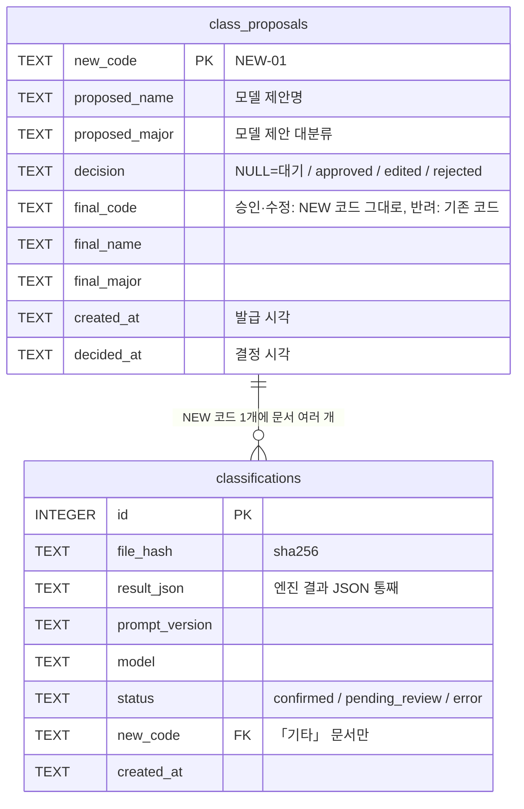

# SQLite 스키마 (프론트 공유용, 2026-10-08 작성, 10-11 연결 반영)

데모 저장소(`src/db/store.py`의 `SqliteStore`)가 쓰는 테이블입니다. 원본은 `src/db/schema.sql`입니다.
데모는 `app/services.py`의 `open_store()`에서 이 저장소를 엽니다(PR #36·#39). 예전 메모리 `Store`는 #39에서 삭제했습니다.

## 한눈에 보기



## 테이블

### `classifications` (분류 결과)

문서 1건을 1번 분류할 때마다 1행이 생깁니다.

| 열 | 내용 |
| --- | --- |
| `id` | 자동 증가 번호. 화면이 쓰는 결과 `id` |
| `file_hash` | 업로드 파일의 sha256 (`save_upload()`가 이미 계산함) |
| `result_json` | 엔진 결과 JSON 통째 (회의 문서 3절 형식). **모델이 낸 그대로 두고, 담당자 결정 후에도 고치지 않습니다** |
| `prompt_version`, `model` | 캐시 조회와 재현에 사용 |
| `status` | `confirmed`, `pending_review`, `error` |
| `new_code` | 「기타」로 빠진 문서만 값이 있음. 결정 후에도 남겨 두어 어떤 결정으로 확정됐는지 연결 |
| `created_at` | 분류 시각 |

### `class_proposals` (신규 분류 제안)

NEW 코드 1개당 1행입니다. NEW 코드를 발급할 때(분류 결과를 저장할 때) 만들고, 담당자가 결정하면 결정 열을 채웁니다.

| 열 | 내용 |
| --- | --- |
| `new_code` | `NEW-01` 형식 |
| `proposed_name`, `proposed_major` | 모델 제안 (비어 있을 수 있음) |
| `decision` | 비어 있으면 승인 대기. `approved`, `edited`, `rejected` |
| `final_code` | 승인·수정 후 승인이면 NEW 코드 그대로, 반려면 재지정한 기존 코드 (지금 `review.py`와 같은 규칙) |
| `final_name`, `final_major` | 수정 후 승인에서 이름·대분류를 바꿀 수 있어서 둠 |
| `created_at`, `decided_at` | 발급 시각, 결정 시각 |

### DB가 막아 주는 것

- 「기타」 문서인데 NEW 코드가 없는 행
- 없는 NEW 코드를 가리키는 행 (연결마다 `PRAGMA foreign_keys = ON` 필요)
- 결정은 했는데 결정 시각이나 정식 코드가 없는 행
- 정해진 값 밖의 `status`, `decision`

## 승인 흐름: NEW 코드 하나에 문서 여러 개

1. 문서 A, B가 모두 "출장정산서"로 제안되면 발급기가 같은 `NEW-01`을 줍니다.
2. `class_proposals`에 `NEW-01` 1행, `classifications`에 A, B 2행(`new_code = NEW-01`, `status = pending_review`)이 생깁니다.
3. 승인 대기 화면은 `NEW-01` 그룹 하나에 문서 2건을 보여 줍니다.
4. 담당자가 결정하면 한 트랜잭션에서 `class_proposals` 1행에 결정을 쓰고, A, B를 `confirmed`로 바꿉니다.

## 저장소 메서드와 SQL 대응

메서드 이름과 돌려주는 형태는 예전 메모리 `Store`와 같습니다. 그래서 SQLite로 바꿀 때 **화면 코드는 바뀌지 않았습니다.**

| 메서드 | SQL |
| --- | --- |
| `save_result(result)` | `classifications` INSERT. `pending_review`이고 처음 보는 NEW 코드면 `class_proposals`도 INSERT (한 트랜잭션) |
| `find_cached(hash, ver, model)` | `get()`과 같은 LEFT JOIN + 결정 값 덮어쓰기, `WHERE file_hash=? AND prompt_version=? AND model=? AND status<>'error' ORDER BY id DESC LIMIT 1`. 결정 후 같은 파일을 다시 올리면 **확정된 결과**가 재사용됨 (원본 `pending_review`를 재사용하면 확정되지 않는 행이 생김) |
| `get(id)`, `list_history()` | `classifications` LEFT JOIN `class_proposals`. 결정된 문서는 `final_*` 값을 결과 dict에 덮어서 돌려줌 |
| `list_pending()` | `classifications`, `WHERE status='pending_review' ORDER BY id` |
| `list_pending_groups()` | `class_proposals` JOIN `classifications`, `WHERE decision IS NULL AND status='pending_review'` |
| `decide_group(...)` | `class_proposals` UPDATE + `classifications` UPDATE `status='confirmed'` (한 트랜잭션) |
| 서버 시작 시 발급기 복원 | `taken`은 `class_proposals` **전체**의 `new_code`, `by_name`은 **`decision IS NULL`인 행만**의 `proposed_name` → 재시작해도 번호 유지, 결정된 이름은 새 번호 |

## 구현: `src/db/store.py`의 `SqliteStore`

화면이 쓰는 메서드 7개와 `allocator` 속성을 가집니다(`tests/test_db_store.py`가 시나리오로 검사). 저장소를 만드는 곳은 `app/services.py`의 `open_store()` 한 곳뿐이고, `main.py`가 서버 전체에서 한 번 부릅니다.

```python
def open_store() -> SqliteStore:
    name = "docsense_mock.sqlite3" if is_mock() else "docsense.sqlite3"
    return SqliteStore(DB_DIR / name, taxonomy())   # DB_DIR = data/db/ (.gitignore)
```

- **MOCK과 실제 모드는 DB 파일을 따로 씁니다.** 캐시는 모델 이름(`mock`)으로 이미 나뉘지만, NEW 번호와 승인 대기는 같은 파일이면 섞이기 때문입니다.
- 모드(`DEMO_MOCK`)는 서버를 켤 때 정해집니다. 바꾸려면 데모를 다시 켭니다.
- 초기화: 데모를 끈 뒤 해당 DB 파일을 지웁니다.
- 테스트는 `SqliteStore(":memory:", ...)`를 쓰고, `open_store()` 테스트는 `DB_DIR`을 `tmp_path`로 바꿔 실제 `data/db/`를 건드리지 않습니다.

## 예전 메모리 `Store`와 달라진 점

- **결과 JSON을 덮어쓰지 않습니다.** 메모리 `Store`의 `decide_group()`은 결과 dict의 `minor_code` 등을 직접 바꿨습니다. DB에서는 원래 결과를 그대로 두고 결정은 `class_proposals`에만 씁니다. 화면에 보이는 값은 `get()`, `list_history()`가 합쳐서 돌려주므로 예전과 같습니다. 원래 모델 판단과 사람 결정을 나중에 비교할 수 있습니다.
- **서버를 다시 켜도 이력과 NEW 번호가 남습니다.**

## 프론트와 정한 것 (PR #9 검토 의견, 2026-10-08)

1. **결정된 문서의 화면 표시 → 확정 값만.** 원래 모델 값은 `result_json`에 남아 있으니, 비교가 필요해지면 그때 `get()`에 키를 추가합니다.
2. **결정이 끝난 제안명이 다시 나올 때 → 새 NEW 번호.** 이미 결정된 코드에 붙이면 승인 대기에 보이지 않기 때문입니다.
   - 서버 시작 시 발급기의 `by_name`은 결정 안 된 제안만으로 채웁니다 (`taken`은 전체라 번호는 재사용하지 않음).
   - `decide_group()`은 결정한 NEW 코드의 이름을 `by_name`에서 지웁니다. (메모리 `Store`는 #39에서 삭제되어 이 규칙은 `SqliteStore`에만 있습니다.)
3. **오류 결과는 이력에 계속 보여 줍니다.** 캐시 조회에서만 `status<>'error'`로 뺍니다.
4. **시각 형식:** `datetime.now().isoformat(timespec="seconds")` 로컬 시각 문자열.

반영 요청 0번(`find_cached()`도 결정 값을 덮어서 반환)은 위 대응표에 반영했습니다.
