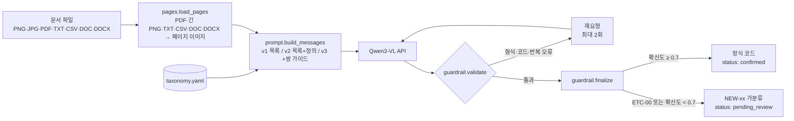

# 분류 엔진 (src/engine) 작업 정리 — 백엔드 1

> 담당: 백엔드 1 (분류 엔진) · 최종 갱신: 2026-10-11
> 분류 엔진의 지금까지 작업, 실험 기록, 사용법, 팀원에게 알릴 사항, 앞으로 할 일을 정리했습니다.
> 프로젝트 전체 소개(배경, 분류 체계, 데이터셋, 일정, 협업 규칙)는 저장소 루트의 README를 보세요.

문서 파일(PNG·JPG·PDF·TXT·CSV·DOC·DOCX, DOC·DOCX는 LibreOffice 필요) 1건을 Qwen3.7-Plus(`qwen3.7-plus-2026-05-26`)에 보내 대분류·소분류·확신도·판단 근거·근거 영역(bbox)을 결과 JSON으로 돌려주는 엔진입니다.

**현재 상태 한눈에 (10-11)**

- 엔진 기능(1장 분류, 다중 페이지, 가드레일, 「기타」 제안, 일괄 실행, 데모 연동) 완료. 전체 테스트 89 passed, 1 skipped
- 모델: `qwen3.7-plus-2026-05-26` (날짜 스냅샷 고정). 기존 `qwen3-vl-plus-2025-12-19`가 10-10 지원 종료(404)돼 교체(#37)
- 증량 개발셋 264건 소분류 정확도(새 모델, 같은 조건 2회 평균): 가드레일 #42 전 v2 99.2%, v3 99.8% → **#42 후 v2 99.8%, v3 100.0%** (목표 90% 이상). 옛 모델의 v2 기준선은 97.3%였지만 모델이 달라 직접 비교하지 않음
- v3는 v2에 LEG-01↔LEG-02 구분 가이드를 더한 버전. v2와의 차이(1.5건)는 흔들림 범위 안이라 "해롭지 않다"까지만 말할 수 있음
- #42 전 오답 5건은 모두 모델이 확신도 0.95로 「기타」를 고른 경우이고 4건은 제안 이름이 기존 소분류 이름과 같았음 → 가드레일(#42) 후 재측정에서 오답 합계 v2 4건→1건, v3 1건→0건. 남은 1건은 이름 뒤 괄호 설명(`비밀유지계약서 (NDA)`)이 비교를 빠져나간 것이라 #46에서 보완. **표본이 작아 효과를 단정하지 않음**
- `add_minor()`와 `TAXONOMY_PATH`는 구현해 병합(#45), 프론트가 승인 화면에 연결해 병합(#48)
- 새 모델 기준선 보완(10-12): v1 clean **99.6%**, v2 hard **100.0%**(변형 4종 모두 100%), 개발용 OOD 「기타」 판정률 **100%**(20/20). 하드셋 변형이 약하고 개발용 OOD는 쉬운 조건이라 만점을 강건성의 증거로 쓰지 않음
- 아직 안 한 것: 최종 OOD 60장(프롬프트 동결 후 1회), 테스트셋

---

## 0. 지난 발표(10-07) 대비 이번 주 진행 (백엔드 1)

### 0-1. 한눈에 비교

| 항목 | 지난 발표 | 이번 주 |
| --- | --- | --- |
| 개발셋 | 초기 88건 (여러 쪽 문서는 첫 쪽만) | 증량 **264건**, `_p1`·`_p2` 페이지 PNG를 한 문서로 묶어 분류 |
| 모델 | `qwen3-vl-plus` (날짜 없는 별칭) | 날짜 스냅샷 고정(`qwen3-vl-plus-2025-12-19`) → 10-10 지원 종료로 **`qwen3.7-plus-2026-05-26`** 교체 |
| 프롬프트 | v1, v2 (v3·v4는 계획) | **v3 추가**(LEG 구분 가이드) → 첫 판 실패 분석 후 다시 씀 |
| 측정 방식 | 실행당 1회, 평균·폭 없음 | 같은 조건 2회 이상, 평균·95% 신뢰구간·Macro-F1, 오류 건수, 토큰·비용 기록 |
| 소분류 정확도 | v1 92.0% → v2 96.6% (최고 97.7%), 88건 | 264건: 옛 모델 v2 97.3% → **새 모델 v2 99.2%, v3 99.8%** → 가드레일 #42 후 **v2 99.8%, v3 100.0%** |
| 오분류 원인 | LEG-02 정의, HR-03 정의, 근거 문장 반복 | LEG-01·02 정의 비대칭, v3 초판의 응답 형식 오류, FIN-09 정의 불일치, 그리고 남은 「기타」 선택 |
| 가드레일 | 검사 6가지, 이름·코드 불일치 재요청 | 검사 추가 2가지(잘못된 이스케이프 허용, 기존 이름을 신규 제안하면 재요청) + 불일치 재요청에 정식 이름 안내 |
| 비용 | 총 15~20달러 예상 (추정) | 264건 1회 약 **$0.93** 측정 (입력 1.8M·출력 0.13M 토큰) |
| 처리 시간 | 88건에서 문서당 8~15초 기록만 | 264건 문서당 중앙값 8.4~9.1초, 95% 지점 13.9~17.8초 (페이지당 시간은 아직 안 구함) |

### 0-2. 정확도 흐름 (소분류)

모델·문서 수가 다른 구간은 직접 비교하지 않습니다. 같은 칸 안에서만 비교하세요.

| 구간 | 데이터 | 모델 | 실행 | 소분류 |
| --- | --- | --- | --- | --- |
| 지난 발표 | dev 88건 | `qwen3-vl-plus` | v1 | 92.0% (81/88) |
| | | | v2 ③ (최고는 v2 ② 97.7%) | 96.6% (85/88) |
| 이번 주 ① | dev 264건 | `…2025-12-19` | v2 r1~r5 (정의를 세 번 바꾸며 측정) | 94.7~98.5% |
| | | | v2 r4·r5 (같은 정의) | 97.7%, 97.0% → 평균 **97.3%** |
| | | | v3 초판 r1·r2 (채택 안 함) | 96.9%, 97.3% (응답 오류 뺀 성공 기준) |
| 이번 주 ② | dev 264건 | `qwen3.7-plus-2026-05-26` | v2 r1·r2 | 99.2%, 99.2% → 평균 **99.2%** |
| | | | v3 r1·r2 (다시 쓴 가이드) | 100.0%, 99.6% → 평균 **99.8%** |
| 이번 주 ③ (가드레일 #42 후) | dev 264건 | `qwen3.7-plus-2026-05-26` | v2 r1·r2 | 100.0%, 99.6% → 평균 **99.8%** |
| | | | v3 r1·r2 | 100.0%, 100.0% → 평균 **100.0%** |

- 새 모델에서는 LEG-01·LEG-02 혼동과 LEG-02 → 「기타」가 4회 모두 0건입니다.
- 수치 전체와 실행별 표는 `results/eval_comparison.md` 0절, 실행 taxonomy 커밋은 `results/README.md`에 있습니다.

### 0-3. 이번 주 한 일

| 분류 | 한 일 | PR |
| --- | --- | --- |
| 측정 환경 | 264건 측정(`--out`으로 실행 이름 분리, 이어서 실행, 토큰 `usage`), 실행마다 모델·taxonomy 커밋·이미지 Release 기록 | #5, `results/README.md` |
| 정의–데이터 불일치 | LEG-01만 고쳐 두 정의가 비대칭이 된 것을 발견(95.8%·94.7%로 하락) → 같은 구조로 수정. FIN-09 정의가 실제 문서와 달랐던 것(감사의견·감사범위·핵심감사사항은 15건 중 0건, 실제 필드는 15건 모두)을 찾아 수정 | #16, #23, #31 |
| v3 프롬프트 | 헷갈림 쌍 LEG-01↔LEG-02 가이드 추가(HR-03↔FIN-06은 오분류 0건이라 제외). 첫 판은 LEG-02를 못 고치고 LEG-01 응답 오류 6건이 생겨 채택 안 함 → 제목 옮겨 적기·minor_name 규칙으로 다시 씀 | #19, #30 |
| 가드레일 | JSON의 `\'` 허용, 이름·코드 불일치 재요청에 정식 이름 안내, 「기타」인데 기존 소분류 이름을 신규 제안하면 재요청 | #29, #42 |
| 모델 교체 | 10-10 404 → 결제·카드 정상 확인 → 지원 종료 공지로 원인 확인 → 후속 모델로 교체, 호출·bbox 확인 후 기본값·문서 갱신 | #37 |
| 새 기준선 | 새 모델로 v2·v3 각 2회 측정(264건 × 4회, 오류 0건) 후 결과·분석 기록 | #41 |
| 리뷰 | 백엔드 2의 결과 문서 PR 검토(수치 재채점) | #38 |

### 0-4. 계획 체크리스트 (2일 차·3일 차)

| 상태 | 계획 | 실제 |
| :---: | --- | --- |
| ✅ | v2 clean 2회차 시작 | `v2_clean_r1`~`r5`(옛 모델)와 `q37_v2_r1`·`r2`(새 모델) |
| ✅ | v2 hard `v2_hard_r1` | `q37g_v2_hard_r1` 100.0% (264/264), 변형 4종 모두 100% |
| 🔶 | v2 OOD `v2_ood_r1`(60장) | 개발용 OOD 20장으로 `q37g_v2_ood_dev_r1` 「기타」 판정률 100%(20/20). 최종 OOD 60장은 테스트셋 규칙에 따라 프롬프트 동결 후 1회만 평가하므로 하지 않음 |
| ✅ | v1 clean `v1_clean_r1` | `q37g_v1_clean_r1` 99.6% (263/264), 새 모델의 v1 기준선 |
| ✅ | 오류 줄을 같은 명령으로 다시 실행해 0건으로 | 새 모델 4회 모두 오류 0건. 옛 모델 `v3_clean_r1`·`r2`의 오류 6건은 새 모델 측정으로 대체 |
| ✅ | 결과 폴더 공유, 실행마다 시간·토큰 기록 | 결과는 PR로 공유, 시간·토큰은 `predictions.jsonl`의 `latency_ms`·`usage`와 `eval_comparison.md` 0절 |
| ✅ | v3에서 다룰 헷갈림 쌍 확정 | LEG-01↔LEG-02 확정, HR-03↔FIN-06은 오분류 0건이라 제외 |
| ✅ | v3 프롬프트 (`PROMPT_VERSIONS`에 v3) | #19, 다시 쓴 판 #30. `python -m src.engine.prompt v3`로 확인 |
| ✅ | v3 clean 실행 `v3_clean_r1` (시간이 되면 `r2`) | 옛 모델 `v3_clean_r1`·`r2`, 새 모델 `q37_v3_r1`·`r2` |
| ✅ | `add_minor()` 구현 | 구현·테스트 완료, 병합(#45) (대분류 접두어의 다음 번호 발급, 중복 이름·없는 대분류·「기타」 대분류 거부, 임시 파일 테스트) |
| ✅ | 안건 5를 채택했다면 로더가 `TAXONOMY_PATH`를 읽게 수정 | 채택해 구현·병합(#45). `.env`의 `TAXONOMY_PATH`가 있으면 데모 복사본을 읽고, 평가(`src.engine.run`)는 항상 원본을 읽음 |
| ✅ | 프론트에게 `add_minor()` 사용법 공유 | PR #45 설명과 댓글에 호출 순서·오류 처리를 적었고, 프론트가 `review.py`에 연결해 병합(#48) |
| 🔶 | `src/engine/README.md` 실험 기록 갱신 | 이 문서. 264건 v2·v3와 모델·비용은 반영, v1·hard·OOD는 측정 후 |

### 0-5. 계획에 없었지만 한 일

- 모델 지원 종료(10-10) 대응과 새 모델 기준선 재측정 — 계획의 "고정 모델로 기준선" 전제가 깨져 다시 잼
- v3 초판 실패 원인 분석(응답 형식 오류 6건, LEG-02 제목 누락)과 다시 쓰기, 가드레일 보강 3건
- 정의–데이터 불일치 추가 발견(LEG 정의 비대칭, FIN-09)
- 백엔드 2의 `compare_runs.py`로 같은 정의인데 실행마다 답이 바뀌는 문서를 모아 원인을 확인(`results/analysis/`)

---

## 1. 내가 한 일 (1~2주 차)

| 분류 | 한 일 | 위치·커밋 |
| --- | --- | --- |
| API 연동 | 제공처 비교 후 Alibaba Cloud Model Studio(싱가포르) 선택, 첫 호출 성공 (손익계산서 PDF → FIN-03, 0.98, 약 8초) | `classify.py`, `results/check/FA-PL-01.json` |
| 좌표 형식 | bbox가 0~1000 상대 좌표 `[x1, y1, x2, y2]`임을 확인, 프론트에 안내 문서 공유 | 5절 |
| 입력 처리 | PDF → 페이지별 이미지, 세로로 긴 PNG → A4 비율로 분할, `_p1.png`면 `_p2`… 묶기 | `pages.py` |
| 프롬프트 | `PROMPT_VERSIONS`로 버전 관리 (v1 목록만, v2 + 정의), 근거를 코드보다 먼저 쓰게 출력 순서 변경 | `prompt.py`, `ee83b93` |
| 가드레일 | 형식·코드·확신도·bbox 검증, 이름·코드 불일치·반복 출력 재요청 (최대 2회), 출력 최대 3,000토큰 | `guardrail.py`, `f8edc57` |
| 「기타」 | ETC-00 또는 확신도 0.7 미만 → `NEW-xx` 가분류 + 신규 분류 제안 (같은 제안명, 끝부분이 같은 제안명은 한 코드로) | `guardrail.py` |
| 일괄 실행 | 개발셋 일괄 분류, 끊겨도 이어서 실행, 정확도 요약 | `run.py`, `e5ba41c` |
| 실험 | v1·v2 측정, 오분류 근거 분석, 실행 간 변동(1~3건) 발견 | 7절 |
| 정의 수정 | LEG-01·LEG-02(제목 기준 + '(비즈폼)' 허용), HR-03(직원별 표 포함) — 백엔드 2와 협의 후 반영. '(비즈폼)' 허용 문구는 #7에서 데이터의 표기와 함께 삭제 | `config/taxonomy.yaml` |
| 문서 | 엔진 README, 백엔드 2 요청 사항, bbox 안내, 발표 대본 | 이 문서 |
| 모델 고정 | 날짜 없는 `qwen3-vl-plus` → `qwen3-vl-plus-2025-12-19` | `.env.example`, `6b9cfc7` |

## 2. 할 일 체크리스트와 실행 방법

**1주 차**
- [x] API 제공처 비교, 키 발급, 이미지 1장 분류 호출
- [x] bbox 좌표 형식 확인 후 팀 공유
- [x] 제공처·모델 확정, taxonomy.yaml → 프롬프트 로더, PDF → 페이지 이미지, `classify()`와 v1 프롬프트
- [x] JSON 검증·재요청 가드레일, 파일 해시 결과 캐시(데모, 메모리), 개발셋 전체 실행

**2주 차 1일 차**
- [x] 브랜치 통합(안건 1) — `main`에 반영됨 (#1). `main`에서 `feat/week2-engine` 생성
- [x] 모델 버전 고정 — `.env.example`·엔진·데모 기본값을 `qwen3-vl-plus-2025-12-19`으로. 싱가포르 리전 1건 분류로 정상 응답 확인
- [x] `run.py --out <실행 이름>`, `--split ood`, `usage`(토큰) 기록 — PR #4 (이 브랜치에 병합해 함께 검증)
- [x] 전체 테스트 통과 후 PR
- [x] v2 clean 1회차 (`--out v2_clean_r1`) — PR 병합과 백엔드 2의 정의 대조 후 실행

**2주 차 2~3일 차**: 0-4절 표로 옮겼습니다 (✅ 6 · 🔶 1 · ⬜ 6).

### 2-1. 처음 실행하기 (Windows 기준)

```cmd
git clone <새 저장소 주소>
cd Pre-Capstone
python -m venv .venv
.venv\Scripts\activate
python -m pip install -r requirements.txt
copy .env.example .env
```

`.env`를 열어 `VLM_API_KEY=` 뒤에 Alibaba Cloud Model Studio(싱가포르 리전) API 키를 넣습니다. 이미 `.env`가 있다면 `VLM_MODEL=qwen3.7-plus-2026-05-26`으로 바꿉니다. `.env`는 커밋되지 않습니다.

| 하고 싶은 것 | 명령 |
| --- | --- |
| 테스트 (API 호출 없음) | `python -m pytest tests -q` |
| 모델에 보낼 프롬프트 보기 (키 불필요) | `python -m src.engine.prompt v2` |
| 문서 1건 분류 (모델 확인용) | `python -m src.engine.classify 문서.pdf --prompt v2 --out results/check` |
| 데모 (실제 API) | `.env`에서 `DEMO_MOCK=0`, `PROMPT_VERSION=v2` 후 `streamlit run app/main.py` |

### 2-2. 개발셋 일괄 분류

이미지(`data/images/`)는 git에 올리지 않습니다. 데이터 담당의 `src/eval/render_png.py`·`augment.py --seed 42`로 만들거나 받아서 `data/images/clean/`에 둡니다.

```cmd
python -m src.engine.run --images data/images/clean --prompt v2
```

- 여러 쪽 문서는 `labels.csv`에 `…_p1.png`로 적혀 있고, 엔진이 같은 폴더의 `_p2`, `_p3` …을 모아 한 문서로 보냅니다
- 결과: `results/<버전>/predictions.jsonl`, `summary.txt`. 결과는 `results/` 아래에만 둡니다(루트에 `v1/` 같은 폴더를 만들지 않음)
- 중간에 끊기거나 오류(`Connection error`, `Request timed out`)가 나도 같은 명령을 다시 실행하면 성공한 문서는 건너뜁니다
- 실행 이름: 끝에 `--out v2_clean_r1`을 붙이면 `results/v2_clean_r1/`에 저장합니다(생략하면 `results/<버전>/`). 이어받는 기준은 실행 이름이라 **이름이 다르면 처음부터** 분류합니다. 정의나 프롬프트를 고친 뒤에는 새 이름으로 실행합니다
- OOD셋: `--split ood`. `data/meta/ood_labels.csv`를 읽고 정답은 `gold_code` = `OOD-01`~`OOD-03`, `gold_major` = null. `summary.txt`에는 정확도 대신 「기타」 판정률(`pending_review` 비율, 전체·종류별)
- 토큰 사용량: 각 줄에 `usage` = `{"input_tokens", "output_tokens"}` (재요청 포함 문서 1건 합계). 오류로 끝난 문서도 쓴 만큼 남고, 제공처가 값을 안 보내면 0. 비용은 이 값을 합산
- 재요청 사유: 재요청이 있었던 문서의 줄에만 `retry_errors` = 검증에 실패한 시도별 사유 목록(`[["...", ...], ...]`, 사유당 200자까지). 재요청이 없으면 필드가 없다. 결과 JSON 자체는 그대로고 일괄 실행 기록에만 붙는다
- 소분류마다 2건씩 맛보기: 끝에 `--per-class 2`
- 틀린 문서의 근거 보기:
  ```cmd
  python -c "import json; [print(r['file'], r['predicted_code'], r['confidence'], *r['reasons'], r.get('new_class'), sep='\n  ', end='\n\n') for r in map(json.loads, open('results/v2/predictions.jsonl', encoding='utf-8')) if r.get('status')!='error' and r['minor_code']!=r['gold_code']]"
  ```
- 테스트셋(`--split test`)은 프롬프트 동결 전까지 실행하지 않습니다(`--confirm-test` 없이는 거부)

---

## 3. 처리 흐름



| 파일 | 하는 일 |
| --- | --- |
| `taxonomy.py` | `config/taxonomy.yaml`을 읽고 검증, 프롬프트용 분류 목록 텍스트 생성 |
| `prompt.py` | 버전별 프롬프트(`PROMPT_VERSIONS`: v1 목록만, v2 목록+정의, v3 v2+헷갈림 쌍 가이드), 페이지마다 `[n페이지]` 표시 후 이미지 첨부 |
| `pages.py` | PDF → 페이지별 이미지(150 DPI), 세로로 긴 PNG → A4 비율로 잘라 페이지로, 근거 박스 그리기 |
| `guardrail.py` | 응답 JSON 파싱·검증, 재요청 문구, `NEW-xx` 번호 발급, 결과 JSON 생성 |
| `classify.py` | API 호출과 재요청 루프(`Classifier.classify`), 출력 최대 3,000토큰, 명령줄 실행 |
| `run.py` | 개발셋 일괄 분류, 이어서 실행, 정확도 요약 |

---

## 4. 결과 JSON (엔진·평가·화면 공통 형식)

```json
{
  "file": "FA-PL-01.pdf",
  "major": "재무/회계",
  "minor_code": "FIN-03",
  "minor_name": "손익계산서",
  "confidence": 0.98,
  "reasons": ["문서 제목이 '표준손익계산서'이며 …", "매출액 → 매출원가 → … 흐름을 따름"],
  "evidence": [{"page": 1, "bbox": [390, 85, 600, 108], "label": "문서 제목"}],
  "new_class": null,
  "prompt_version": "v2",
  "model": "qwen3.7-plus-2026-05-26",
  "latency_ms": 8265,
  "status": "confirmed",
  "predicted_code": "FIN-03",
  "retries": 0
}
```

- `status`: `confirmed`(확정) · `pending_review`(「기타」, 담당자 승인 대기) · `error`(재요청 2회 후에도 실패, `errors`에 이유)
- `predicted_code`: 모델이 원래 고른 코드. 확신도가 낮아 `NEW-xx`로 바뀌어도 평가·오분류 분석에 씀
- `new_class`: 「기타」일 때 `proposed_name`, `proposed_major`, `reason`, `trigger`(`etc` | `low_confidence`)
- 일괄 실행 결과에는 `gold_code`, `gold_major`, `split`, `usage`(재요청이 있었다면 `retry_errors`도)가 더 붙습니다. 결과 JSON 자체는 그대로입니다
- 형식을 바꾸면 `tests/test_mock_samples.py`가 실패하므로 `app/mock/samples/`도 함께 고칩니다. 형식 변경은 팀 합의 후 진행합니다.

---

## 5. 근거 영역(bbox) 좌표

- `bbox` = `[x1, y1, x2, y2]`, (x1, y1) 왼쪽 위 · (x2, y2) 오른쪽 아래, 페이지 가로·세로를 각각 **0~1000**으로 본 상대 좌표 (Qwen3-VL 형식, 픽셀 아님)
- 픽셀 = 값 ÷ 1000 × 이미지 크기. 예: 1240×1754 이미지에서 `[390, 85, 600, 108]` → x 484~744, y 149~189
- `page`는 1부터. 엔진이 값 범위, `x1<x2`·`y1<y2`, 페이지 범위를 검증하고 어기면 재요청
- 실제 결과에서 박스가 제목·상호·과세기간 위치와 일치함을 확인. 작은 글씨는 페이지의 1~2% 정도 어긋날 수 있음
- 박스는 대표 근거 1~3곳만 표시(표 본문은 근거 문장에만 나오고 박스가 없을 수 있음)
- 모델을 Qwen2.5-VL 계열로 바꾸면 픽셀 좌표가 되므로 다시 확인 필요

---

## 6. 가드레일 (응답 검증 → 재요청)

모델 응답은 외부 입력으로 보고 아래를 검사합니다. 하나라도 어기면 오류 내용을 알려 주며 최대 2회 재요청하고, 그래도 실패하면 `status: "error"`를 돌려줍니다.

| 검사 | 예 | 추가 계기 |
| --- | --- | --- |
| JSON 형식 | 코드블록으로 감싼 응답도 처리 | |
| 분류 체계에 있는 코드인지 | `FIN-99` → 재요청 | |
| 소분류 이름과 코드가 맞는지 | 이름 "손익계산서" + 코드 `FIN-02` → 재요청 (공백·가운뎃점·괄호, 이름에 붙인 코드는 무시, 「기타」 제외). 재요청 문구에 정식 이름을 알려 줌 | 7-1 첫 오분류, 7-6 (#29) |
| 확신도 0~1 숫자인지 | `"높음"` → 재요청 | |
| 근거 문장 리스트인지 | 빈 리스트 → 재요청 | |
| 근거 문장이 400자 이하인지 | 같은 말을 수천 자 되풀이 → 재요청 | 7-4 반복 출력 |
| bbox·page 형식 | 위 5절 | |
| 「기타」면 신규 분류 제안이 채워졌는지 | 제안명·대분류·이유 중 빈 값 → 재요청 | |
| 「기타」인데 제안 이름이 기존 소분류 이름인지 | "감사 보고서"를 신규 제안 → FIN-09 코드·이름을 알려 재요청 | 7-6 새 모델 오답 5건 중 4건 (#42) |
| JSON 안의 잘못된 이스케이프 | 작은따옴표를 `\'`로 쓴 응답 → 이스케이프를 지우고 다시 파싱 (재요청 아님) | 7-6 v3 초판 LEG-01 4건 (#29) |

- 확신도가 기준(`CONFIDENCE_THRESHOLD`, 기본 0.7) 미만이면 정식 코드라도 `NEW-xx`로 가분류해 담당자 확인을 받습니다.
- 응답 길이는 최대 3,000토큰(정상 응답은 1,000토큰 안팎). 반복 출력으로 요금이 커지는 것을 막습니다.

---

## 7. 실험 기록

7-1~7-5는 1~2주 차 기록입니다: 모델 `qwen3-vl-plus`(날짜 고정 전 별칭), 확신도 기준 0.7, 초기 분할(fewshot 22 / dev 88 / test 110) 중 **dev 88건**, 실행마다 1회. 「기타」로 빠진 건은 오답으로 셉니다. 3주 차 264건 기록은 7-6과 `results/eval_comparison.md`에 있습니다.

### 결과 요약

| 실행 | 바꾼 것 | 대분류 | 소분류 | 남은 오분류 |
| --- | --- | :---: | :---: | --- |
| v1 | 분류 목록만 (zero-shot) | 97.7% | 92.0% (81/88) | LEG 쌍 5건, 감사보고서→「기타」 2건 |
| v2 ① | + 소분류 정의 | 100% | 94.3% (83/88) | LEG-02 4건 전부 LEG-01로, HR-03 1건 「기타」 |
| v2 ② | LEG 정의를 제목 기준으로 | 100% | 97.7% (86/88) | LEG-02 2건 (「기타」 1, LEG-01 1) |
| v2 ③ | LEG 정의가 '(비즈폼)' 허용 | 100% | **96.6%** (85/88) | HR-03 2건·LEG-02 1건 「기타」 |
| v2 ④ | HR-03 정의 수정 + 반복 출력 재요청 | | | **측정 대기** — 고정 모델 `qwen3-vl-plus-2025-12-19`, 증량 dev 264건으로 |

> v2 ②→③에서 소분류가 1건 줄었지만, 바꾸지 않은 HR-03이 흔들린 것이라 정의 수정의 효과로 보기는 어렵습니다(7-5).
>
> ⚠️ PR #2(`fix/results-v2-final`)의 `results/v2/`(97.7%, `bb454d0`)는 `results/v2_제목정확일치/`와 88건의 처리 시간까지 같은 **v2 ② 실행 결과**입니다. 모델 근거도 '(비즈폼)' 허용 전 LEG 정의를 인용합니다. `results/README.md`의 97.7%는 v2 ②, 96.6%는 v2 ③이며, HR-03 정의 수정(④)을 반영한 측정은 아직 없습니다.

### 7-1. 첫 오분류: 근거와 코드가 어긋남 (v1 개발 중)

| 항목 | 내용 |
| --- | --- |
| 문서 | 표준 손익계산서 PDF (`FA-PL-01`, 3페이지) |
| 증상 | 근거에는 "손익계산서의 전형적 구조"라고 쓰고 코드는 `FIN-02`(원가명세서), 다시 돌리면 `FIN-01`. 확신도 0.95~0.98 |
| 원인 | 출력 형식에서 코드를 근거보다 먼저 쓰게 해서, 판단 전에 코드부터 정해 버림 |
| 해결 | ① 출력 순서를 근거 → 소분류 이름 → 코드로 변경 ② 이름·코드 불일치 시 재요청 (`ee83b93`) |
| 결과 | `FIN-03` 정답, 재요청 0회 |

그 밖에: 출력 예시 좌표를 숫자 대신 `[x1, y1, x2, y2]` 자리표시자로(모델이 숫자를 베끼지 않도록), 이미지 앞에 `[n페이지]` 표시(근거의 page 번호 기준을 맞춤).

### 7-2. v1 기준선

- 오분류 7건은 두 유형뿐, 나머지 17개 소분류는 전부 정답
  - **LEG 쌍**: 상가건물 임대차(LEG-01) ↔ 표준임대차(LEG-02)가 서로 섞임. 이름만으로는 구분 기준이 없음
  - **감사보고서 → 「기타」**: 내부감사 발견사항·권고 형식이라 이름만으로 연결하지 못함
- 틀린 답의 확신도가 0.95 이상이라 **확신도 기준만으로는 오분류를 걸러낼 수 없음**
- 가드레일 오탐 1건 수정: 모델이 이름을 "HR-03 연봉 실수령액표"처럼 코드를 붙여 써서 불일치로 잘못 판정 → 이름에 붙인 코드·괄호는 무시 (`7ee7148`)

### 7-3. v2: 정의 추가와 정의–데이터 불일치 발견

- 정의를 넣자 감사보고서 4/4, 상가건물 임대차 4/4로 개선
- 그런데 **표준임대차 LEG-02가 0/4**: 정의는 "상가 특유 조항(환산보증금·관리비) 없이"인데 실제 표준임대차 문서에도 "임차 상가건물의 표시", 환산보증금, 관리비가 있음. 모델은 정의대로 LEG-01을 고름
- 두 양식을 실제로 가르는 것은 제목 → 정의를 제목 기준으로 수정 (`19a663f`) → LEG-02 2/4
- 남은 2건의 근거: "제목이 '표준임대차계약서'가 아닌 '(비즈폼)표준임대차계약서'". 비즈폼 원본 양식은 모두 제목 앞에 `(비즈폼)`이 붙어 있음 → 정의에 "제목 앞에 '(비즈폼)' 같은 양식 출처 표기가 붙을 수 있음" 추가 (`e1195a1`) → LEG-02 3/4

### 7-4. v2 ③의 「기타」 3건 원인과 조치 (`f8edc57`)

| 문서 | 원인 | 조치 |
| --- | --- | --- |
| `HR-03_003`(0.65), `HR-03_013`(0.95) | 정의는 "연봉 **구간별** 급여 기준표"인데 실제 생성 문서(`HR-SAL*` 60개 전부)는 **직원별**(사번·성명·부서·직급) 표. 모델이 "구간별이 아니라 개인별"이라며 「기타」로 보냄 | 정의를 두 형태 모두 포함하도록 수정, FIN-06(소득총액신고서)과의 구분 기준(월 실수령액 중심) 추가 |
| `LEG-02_003`(0.65) | 근거 문장이 "'표준임대차계약서'가 아니라 '표준임대차계약서'도 아니고…"를 수천 자 되풀이한 **반복 출력**. 형식은 맞아 가드레일 통과 | 근거 문장 400자 초과 시 재요청, 출력 최대 3,000토큰 |

### 7-5. 배운 점

1. **오분류의 주원인은 프롬프트가 아니라 정의–데이터 불일치였습니다.** LEG-02·HR-03 모두 모델은 정의를 충실히 따랐고, 정의가 실제 문서와 달랐습니다. 정의는 실제 생성 문서를 보고 써야 합니다.
2. **같은 프롬프트라도 실행마다 1~3건이 바뀝니다.** `temperature=0`이어도 API 결과가 고정되지 않습니다. 88건에서 1~3%p 차이는 흔들림 범위일 수 있으므로, 버전 비교는 개발셋을 2회 돌려 평균과 폭을 함께 기록합니다.
3. **틀린 답도 확신도가 높습니다(0.92~0.98).** 확신도만으로는 오분류를 거를 수 없고, 근거 문장을 읽어야 원인이 보입니다.
4. 소분류당 dev 문서가 4건이라 1건이 25%p입니다. 확정 수치는 프롬프트 동결 후 테스트셋에서 냅니다.
5. API 연결 오류(`Connection error`, `Request timed out`, `Download multimodal file timed out`)는 재실행으로 해결됩니다. 오류는 정확도 계산에서 빠지고 다음 실행 때 다시 시도합니다.

### 7-6. 증량 dev 264건 (3주 차)

조건: 264건(소분류당 12건, HR-01·HR-03·SAL-01은 24건), 이미지 Release `data-clean-20261008`, 테스트셋 0건. 같은 정의로 2회 이상 재서 비교합니다.

| 단계 | 일어난 일 | 조치 |
| --- | --- | --- |
| 정의 비대칭 | `v2_clean_r2`·`r3`에서 95.8%, 94.7%로 하락. LEG-01만 고쳐 두 정의의 구조가 달라지자 LEG-01↔LEG-02가 서로 바뀜 | 두 정의를 같은 구조로 수정(#23). r4·r5 평균 97.3% |
| v3 초판 | LEG-02는 5/12·7/12로 v2와 같았음. 근거가 "제목이 '표준임대차계약서'가 아니다"인데 실제 제목은 그 글자(LEG-02_015·_012의 제목 영역 이미지는 픽셀 단위로 같아, 이미지 품질이 아니라 모델의 판단 문제). 새로 LEG-01 응답 오류 6건: minor_name에 문서 제목을 쓴 이름·코드 불일치 2건, `\'` 때문에 생긴 JSON 오류 4건 | 가드레일 보강(#29), 제목을 근거 첫 문장에 옮겨 적은 뒤 고르게 가이드를 다시 씀(#30). 초판은 채택 안 함 |
| FIN-09 | → 「기타」가 실행마다 다른 문서에서 1~2건. 정의의 감사의견·감사범위·핵심감사사항은 실제 15건 중 0건, 감사기간·감사목적·피감사부 등은 15건 모두 | 정의를 내부감사 보고서 기준으로 수정(#31) |
| 모델 교체 | 10-10 12-19 스냅샷이 404. 같은 키로 별칭·09-23은 호출되나 지원 종료 공지에 같이 올라 있어 후속 `qwen3.7-plus`로 교체 | #37. 호출·bbox 1건 확인(근거 박스는 좌표계는 맞고 위치가 조금 어긋남) |
| 새 기준선 | v2 99.2%·99.2%, v3 100.0%·99.6%. LEG 혼동 0건. 오답 5건은 모두 모델이 확신도 0.95로 「기타」를 고른 경우, 4건은 제안 이름이 기존 소분류 이름 | 가드레일 #42 |
| 가드레일 후 재측정 | v2 100.0%·99.6%, v3 100.0%·100.0% (`q37g_*`). 재요청 7건 모두 재요청 뒤 정답, 오답 합계 v2 4→1건·v3 1→0건. 남은 1건은 `비밀유지계약서 (NDA)`를 신규 제안(괄호 설명 때문에 이름 비교를 빠져나감) | #46으로 보완. 표본이 작아 **효과 단정은 아직 못 함**(같은 코드의 v2 r1·r2도 1건 차이) |

- (가드레일 전) v2 두 실행 사이에 답이 바뀐 문서는 4건, v3는 1건입니다(가드레일 후 v2 1건, v3 0건). v3 평균이 0.6%p 높지만 95% 신뢰구간이 겹쳐 흔들림 범위로 봅니다.
- 소분류당 12건이라 한 건이 8%p입니다. 확정 수치는 프롬프트 동결 후 테스트셋에서 냅니다.
- 새 모델에서도 근거 박스는 제목·표를 대체로 감싸지만 세로로 조금 내려가는 경우가 있습니다(FIN-03 1건 확인). 여러 건 확인 전이라 프롬프트는 바꾸지 않았습니다.

---

## 8. 팀원에게 알릴 것

**프론트 담당**
- 근거 박스 그리는 함수를 엔진(`src/engine/pages.py`)으로 옮겼습니다. `services.draw_evidence`, `services.load_preview_pages`는 그대로 쓰면 되고 화면 수정은 필요 없습니다.
- `app/views/review.py` 1줄: 「기타」 대분류 이름을 taxonomy.yaml에서 읽도록 변경(동작 동일).
- 결과 JSON 형식은 바뀌지 않았습니다. bbox 형식은 5절과 공유한 안내 문서를 보세요.
- 데모에서 v2를 쓰려면 `.env`에 `PROMPT_VERSION=v2`.
- 모델 기본값이 `qwen3.7-plus-2026-05-26`으로 바뀌었습니다(`app/services.py` 한 줄, #37). 기존 `.env`에 `VLM_MODEL=qwen3-vl-plus-2025-12-19`가 있으면 404가 나니 바꾸거나 지우세요.
- 「기타」로 답한 응답이 재요청을 거쳐 정식 코드로 바뀔 수 있습니다(#42). 결과 JSON 형식은 그대로입니다.

**데이터·평가 담당**
- 요청 사항 전체는 `docs/백엔드2_요청사항.md`(Dayeon 브랜치)에 정리했습니다.
- **정의 수정 3건 (엔진 담당 반영):** LEG-01, LEG-02(제목 기준), HR-03(직원별 표 포함). `config/taxonomy.yaml`, 루트 `taxonomy.yaml`, `src/eval/make_taxonomy.py`를 같은 문장으로 맞췄습니다.
- **요청: 나머지 소분류 정의도 실제 생성 문서와 맞는지 대조해 주세요.** 정의–데이터 불일치가 지금까지 두 번(LEG-02, HR-03) 나왔고, 둘 다 오분류의 직접 원인이었습니다.
- 비즈폼 양식 제목 앞의 `(비즈폼)` 표기는 #7(10-08 병합)에서 데이터와 정의 모두에서 지웠습니다. 결정할 것은 남지 않았습니다. 7절의 v2 ③ 기록은 그 전 정의로 잰 값입니다.
- 일괄 결과는 `results/<버전>/predictions.jsonl`에 문서별로 쌓입니다(결과 JSON + `gold_code`, `gold_major`, `split`). 상세 평가(F1, 혼동행렬)는 이 파일을 읽으면 됩니다.
- 증량 데이터(660건, 페이지별 PNG)는 엔진이 `_p1`부터 모아 읽습니다. 파일 이름 규칙 `<문서>_p<번호>.png`를 유지해 주세요.
- `results/README.md`의 v2 기록(97.7% = HR-03 수정 반영)은 7절 경고대로 v2 ② 결과이니 고쳐 주세요.
- 이번 주 정의 수정: LEG-01·LEG-02를 같은 구조로(#23), FIN-09를 내부감사 보고서 기준으로(#31). 남은 오답은 정의 문제가 아니라 모델이 「기타」를 고르는 유형이라 정의는 지금 고칠 곳이 없습니다.
- hard·개발용 OOD 이미지는 `augment.py`와 `render_ood.py --dev`로 만들었고(시드 고정, `.gitignore`), 측정까지 끝났습니다.
- 남은 정리: 루트의 예전 `dev.csv`·`val.csv` 삭제, `split.py`의 `FALLBACK_MAP`(분류 이름 하드코딩) 제거

---

## 9. 앞으로 할 일

**바로 할 일**
1. ~~가드레일 효과 재측정~~ → 완료(`q37g_v2_r1·r2`, `q37g_v3_r1·r2`). 오답 합계가 줄었고 `error`로 끝난 문서는 없음. #46 병합 뒤 한 번 더 재면 효과를 더 단정할 수 있음(선택, 약 $1.9)
2. ~~v1 264건 기준선~~ → 완료(`q37g_v1_clean_r1` 99.6%). 지난 발표의 v1 92.0%는 88건(첫 쪽만)이라 직접 비교하지 않음
3. ~~hard·개발용 OOD~~ → 완료(hard 100%, OOD 20장 100%). 변형이 약해 만점이므로 더 어려운 변형(저해상도·상단 잘림)은 백엔드 2와 상의. 재요청 사유를 결과에 남겨 hard의 FIN-02·FIN-03 재요청 9건 원인을 보는 것도 후보
4. ~~`add_minor()`~~ → 구현(#45)·프론트 연결(#48) 완료. 남은 일: 이 README에 사용법 추가. ~~이름이 비슷한 NEW 코드 묶기~~ → 제안명의 끝부분이 같으면(공백 제외, 짧은 쪽 4자 이상) 같은 코드로 묶음. 개발 OOD 20건은 3개 → 2개 코드
5. 근거 박스 위치: 여러 문서에서 어긋남이 반복되면 프롬프트 보완

**그다음**
6. **v4 (few-shot)**: `split=fewshot` 문서를 소분류별 예시로 첨부. 비용이 3~4배라 가드레일 재측정 뒤에도 오답이 남을 때만. 지금 남은 오답이 「기타」 선택 유형이라 필요 없을 가능성이 있음
7. 다른 헷갈림 쌍은 새 모델 v1·hard 측정에서 오분류가 나오면 `PAIR_GUIDE`에 추가

**프롬프트 동결 후**
8. 테스트셋(clean 330 + hard 330 + ood, 최종 OOD 60장은 팀 확인 필요) **1회** 평가 → 루트 README 성능표 기록. 그 전에는 열지 않음

**API 비용**: 새 모델 264건 1회 약 $0.93(입력 $0.4·출력 $1.6 / 1M 토큰, 문서 1건 약 $0.0035). 측정 완료 후 남은 것은 테스트셋(1회)과 최종 OOD 60장뿐이라 약 $2~3 예상(이번 보완 측정 3건은 합계 약 $1.9 사용). v4(few-shot)는 1건당 3~4배.

---

## 10. 알려진 한계

- PDF 페이지 수 제한 없음: 수십 페이지 문서는 요청 크기·비용 문제가 생길 수 있음
- 이미지를 원본 해상도 PNG로 보냄: 휴대폰 사진처럼 큰 이미지는 요청 크기 오류 가능
- `NEW-xx` 번호와 결과 캐시: SQLite 저장소 연결(#39)로 재시작 후에도 유지됨. 엔진 쪽 발급기는 저장소가 시작 때 복원해 줌
- 확신도는 모델이 스스로 보고한 값이라 실제 정답률과 다름 (틀린 답도 0.9 이상)
- 같은 입력이라도 실행마다 결과가 1~3% 달라짐 (`temperature=0`에서도)
- 긴 PNG는 겹침 없이 A4 높이로 자름: 경계에 걸린 제목·표 행 때문에 오분류가 보이면 겹침 도입
- 88건의 v1·v2 수치는 날짜 고정 전 별칭(`qwen3-vl-plus`)으로, 264건의 옛 수치는 지원 종료된 `qwen3-vl-plus-2025-12-19`로 잰 값: 새 모델(`qwen3.7-plus-2026-05-26`) 수치와 직접 비교하지 않음. v1은 새 모델로 아직 안 잼
- 합성 데이터 결과라 실제 기업 문서 성능은 검증하지 못함. 새 모델도 같은 정의·데이터로 99%대지만 소분류당 12건이라 한 건이 8%p
- 같은 모델 이름이 앞으로 바뀔 수 있음: 날짜 스냅샷도 이번처럼 지원 종료될 수 있어, 모델 교체 시 기준선을 다시 재야 함

---

## 11. Gemini+Qwen 합산 확정 (`cross_check.py`, 11/16)

두 모델의 결과 JSON을 받아 확정 여부를 붙이는 함수입니다. 함수 자체는 API를 부르지 않습니다(Qwen 429의 2·4·8초 재시도는 호출하는 쪽이 맡음).

**실시간 연결 (11/17)**: 데모(`app/services.py`)와 업로드 검사 서버(`src/api/server.py`)는 실제 모드에서 `make_classifier()`가 만든
`CrossClassifier`로 Qwen·Gemini를 **동시에** 부르고 같은 `cross_check()`로 합칩니다. 평가는 지금처럼 모델별 `run.py` 결과를 아래 명령으로 합칩니다.
- `.env`: `GEMINI_API_KEY`(비우면 Gemini를 부르지 않고 전부 `gemini_unavailable` 미확정), `GEMINI_MODEL`(기본 `gemini-3.1-flash-lite`), `GEMINI_BASE_URL`(기본 Google OpenAI 호환 주소). Gemini 호출 시간 제한 60초.
- Gemini 오류(429·503·시간 초과)는 `gemini_unavailable`, Qwen 예외는 그대로 올라가 데모의 429 재시도·오류 안내가 동작합니다.
- 합산 결과의 `model`은 `Qwen모델+Gemini모델`(키가 없으면 `+gemini 없음`)이라 Qwen 단독으로 낸 예전 캐시 결과를 다시 쓰지 않습니다.
- Gemini 「기타」 번호는 Gemini 쪽 발급기에서만 나오고, Qwen 오류로 Gemini 「기타」를 쓸 때만 저장소 발급기에서 번호를 다시 받습니다.

- **확정**: Qwen이 정식 분류(`status=confirmed`)를 냈고, Gemini도 같은 코드를 정식 분류로 냈으며, Gemini 확신도가 0.95 **이상**일 때(11/17 「1.0만」에서 변경, 근거 `results/prompt_tune/threshold_1117.md`). 나머지는 모두 미확정(담당자 확인 필요)
- 화면에 보일 분류는 Qwen 결과이고 `cross_check` 필드가 붙습니다. Qwen이 오류면 Gemini 결과를, Gemini가 오류(503 등)면 Qwen 결과를 쓰되 미확정입니다. 둘 다 오류면 Qwen 오류 결과를 그대로 돌려줍니다(필드 없음, 캐시 안 함)
- 필드 모양은 프론트 #99 화면(`app/evidence.py`)이 읽는 것과 같습니다:
  `{"confirmed": bool, "reason": "agree|disagree|low_confidence|etc|gemini_unavailable|qwen_unavailable", "threshold": 0.95, "gemini": {"minor_code", "confidence"}}`.
  `etc`(두 모델 모두 「기타」)는 이번에 새로 생긴 값이라 화면 문구는 아직 없습니다(프론트에 알림, 지금은 일반 문구가 보임)

```cmd
python -m src.engine.cross_check results/a_vfinal_qwen_fix/predictions.jsonl results/a_vfinal_gemini_fix/predictions.jsonl
```

같은 세트를 두 모델로 돌린 `predictions.jsonl` 두 개로 확정률과 확정 오답 수를 셉니다. 합격 기준 대조표는 `results/step_backend1_gate_20261116.md`입니다.

### 11-1. 백엔드 1 dev 재측정 ① (세트 1~3, 로컬 실행)

`--taxonomy`를 생략하면 main의 `config/taxonomy.yaml`(정의 수정 반영 100종)로 잽니다. Gemini는 `env_gemini.bat`으로 키·주소·모델을 바꾼 뒤 같은 명령을 실행합니다.

```cmd
call env_qwen.bat
python -m src.engine.run --images data/images/clean --prompt vFinal --out s1_vfinal_qwen
python -m src.engine.run --images data/images/new --labels data/meta/labels_new_minors.csv --prompt vFinal --out s2_vfinal_qwen
python -m src.engine.run --images data/images/expansion --labels data/meta/expansion_labels.csv --prompt vFinal --out s3_vfinal_qwen
```

이미지가 없으면 `python src/eval/render_new_minors.py`·`python -m src.eval.render_expansion`으로 만들고 덮어쓴 라벨 CSV는 `git checkout`으로 되돌립니다. `labels_new.csv`(급여명세서를 옛 HR-04로 적음)는 쓰지 않습니다. Gemini는 실행 이름의 `qwen`을 `gemini`로 바꿉니다. 끝나면 `cross_check`로 세트별 확정률을 재고 대조표 1~3행을 채웁니다.

## 12. 보안 등급 (`security.py`, 11/16)

- 소분류가 정해지면 `config/security_grades.yaml`(100종 전체, 코드별 등급과 근거)에서 기본 등급을 찾아 붙입니다. 배정을 바꾸면 이 파일만 고칩니다. 문서 내용으로 등급을 올리지 않습니다
- `Classifier.classify()` 결과에 `security_grade`(기밀·대외비·사내한정·공개·미산정)와 `grade_basis`(예: "소분류 FIN-03 손익계산서의 기본 등급")가 붙습니다. 오류 결과와 「기타」(분류 체계 밖 문서)에는 붙지 않습니다. 화면은 등급 대신 「분류 체계 밖 문서, 담당자 확인 필요」를 보이면 됩니다
- 분류 체계 안 소분류인데 등급표에 없거나 등급표 파일이 없으면 "미산정"이고 오류를 올리지 않습니다. 등급 이름이 4단계 중 하나가 아닌 줄은 버립니다
- `finalize()`의 키는 그대로라 `app/mock/samples`는 바뀌지 않습니다. MOCK 등급은 프론트 #101이 같은 필드 이름으로 붙입니다
- 등급표는 한 줄 형식(`FIN-03: 기밀`)과 근거를 단 형식(`FIN-10: {grade: 사내한정, basis: "..."}`)을 모두 읽습니다. 근거는 `grade_basis` 괄호 안에 붙습니다
- 보수 처리: `handling_grade()`는 미산정·「기타」·합산 미확정 문서를 최소 `FLOOR`(대외비)로 취급합니다. 표시 등급(`security_grade`)은 그대로이고 결과 JSON도 바뀌지 않습니다
- 지표: `python -m src.engine.security <predictions.jsonl ...> [--gemini <gemini.jsonl>] [--grades 등급표]` → 등급 일치율, 사람에게 넘긴 비율(「기타」·미산정·합산 미확정), 하향 오류(표시 등급, 보수 처리 뒤), 오분류 중 등급 하향 비율
- 등급은 4단계 기밀·대외비·사내한정·공개(11/16 결정, `GRADES`). 11/17 최상위 「극비」를 「기밀」로 바꿈(ISMS-P 인증기준 2.1.3 해설 예시, 「극비」는 법령·표준에 없는 이름). 옛 「일반」·「극비」는 등급표에서 버려지므로 등급표도 4단계 이름으로 씁니다
- 11/17 조정: FIN-09 감사보고서 기밀 → 대외비(외부 감사보고서는 외감법 제23조 공시 대상이라 기밀 근거가 약함, 공시 뒤에는 공개로 수동 조정)
- 향후 과제(엔진 수정 필요, 이번 범위 밖): FIN-03 손익계산서를 내부 작성본(기밀)과 결산 확정·공시본(대외비 이하)으로 나누기, FIN-10 세금계산서 공급받는자가 개인이면 대외비로 올리기. 지금은 둘 다 담당자가 수동 조정합니다
- 근거 조문 대부분은 법령 원문이 아니라 2차 자료(법령 해설·요약 사이트)로 확인했습니다(「보안 등급 법령 연결 기준」 보고서). 법률 자문이 아닙니다
